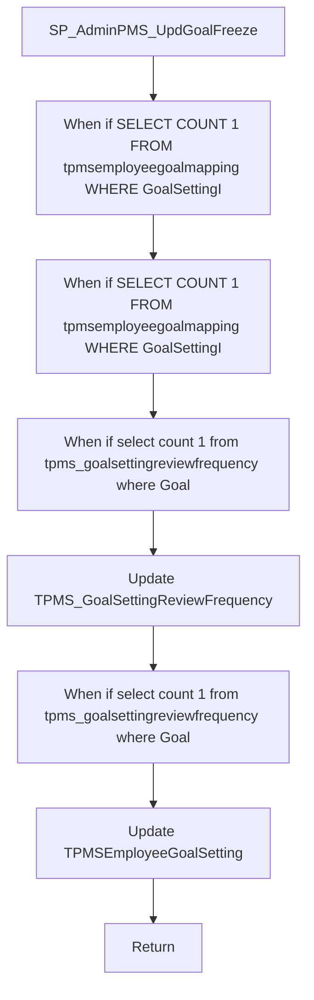

# SP_AdminPMS_UpdGoalFreeze

## What it does

Stored procedure `SP_AdminPMS_UpdGoalFreeze`. Writes `TPMS_GoalSettingReviewFrequency`, `TPMSEmployeeGoalSetting`. Reads `tpmsemployeegoalmapping`, `tpms_goalsettingreviewfrequency`. Calls no other procedure or function.

## Parameters

| Name | Direction | What it is for |
|---|---|---|
| `@GoalSettingId` | in | Int |
| `@ReviewFrequncyId` | in | int, default 0 |

## Call sequence

Calls no other procedures or functions.

## Callers

No other procedure or function calls this object.

## Nested

Calls no other procedures or functions.

## Steps

1. Script is `HRMS-DATABASE/HRMS/STOREPROCEDURE/SP_AdminPMS_UpdGoalFreeze.sql`.
2. When if ((SELECT COUNT(1) FROM tpmsemployeegoalmapping WHERE GoalSettingId =@GoalSettingId and ReviewFrequencyId=@ReviewFrequncyId) = 0)
3. When if ((SELECT COUNT(1) FROM tpmsemployeegoalmapping WHERE GoalSettingId =@GoalSettingId and ReviewFrequencyId=@ReviewFrequncyId
4. When if((select count(1) from tpms_goalsettingreviewfrequency where GoalSettingId=@GoalSettingId and ReviewFrequencyId=@ReviewFrequncyId and IsGoalFreezed=1)=0)
5. Update TPMS_GoalSettingReviewFrequency
6. When if((select count(1) from tpms_goalsettingreviewfrequency where GoalSettingId=@GoalSettingId and IsGoalFreezed=0)=0)
7. Update TPMSEmployeeGoalSetting
8. Else branch.
9. Update TPMS_GoalSettingReviewFrequency
10. When if((select count(1) from tpms_goalsettingreviewfrequency where GoalSettingId=@GoalSettingId and IsGoalFreezed=0)>0)
11. Update TPMSEmployeeGoalSetting

## Tables

| Table | Read or write |
|---|---|
| `TPMSEmployeeGoalSetting` | write |
| `TPMS_GoalSettingReviewFrequency` | write |
| `tpms_goalsettingreviewfrequency` | read |
| `tpmsemployeegoalmapping` | read |

## Flow

