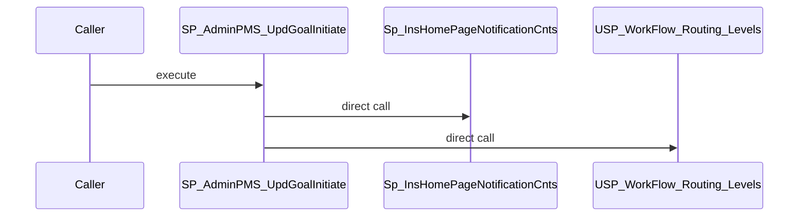
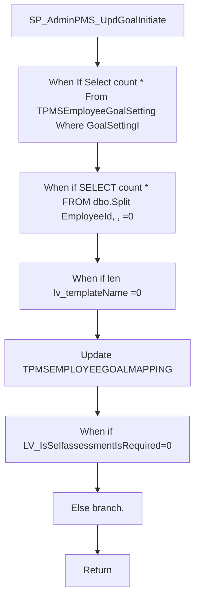

# SP_AdminPMS_UpdGoalInitiate

## What it does

Stored procedure `SP_AdminPMS_UpdGoalInitiate`. Writes `TEmailNotification`, `TPMS_ParkWhatsAppAssessmentMapping`, `TRequestWorkflows`, `TPMSEMPLOYEEGOALMAPPING`, `TPMS_GoalSettingReviewFrequency`. Reads `TPMSEmployeeGoalSetting`, `TEmployee`, `TEmailTemplates`, `tpmsemployeegoalmapping`, `TPMSEmployerConfiguration`, `THomepageNotifications`, `TModulePages`, `TWorkflowManagement`, and others. Calls `Sp_InsHomePageNotificationCnts`, `USP_WorkFlow_Routing_Levels`.

## Parameters

| Name | Direction | What it is for |
|---|---|---|
| `@GoalSettingId` | in | Int |
| `@EmployeeId` | in | VARCHAR(Max) |

## Call sequence

## Callers

No other procedure or function calls this object.

## Nested

| Object | Kind | When | Page |
|---|---|---|---|
| `Sp_InsHomePageNotificationCnts` | procedure | direct call | [Sp_InsHomePageNotificationCnts](/docs/database/hrms/Sp_InsHomePageNotificationCnts) |
| `USP_WorkFlow_Routing_Levels` | procedure | direct call | [USP_WorkFlow_Routing_Levels](/docs/database/hrms/USP_WorkFlow_Routing_Levels) |

## Steps

1. Script is `HRMS-DATABASE/HRMS/STOREPROCEDURE/SP_AdminPMS_UpdGoalInitiate.sql`.
2. When If ((Select count(*) From TPMSEmployeeGoalSetting Where GoalSettingId= @GoalSettingId and IsGoalFreezed=1)=1)
3. When if((SELECT count(*) FROM dbo.Split(@EmployeeId, ','))=0)
4. When if(len(@lv_templateName)=0)
5. Update TPMSEMPLOYEEGOALMAPPING
6. When if(@LV_IsSelfassessmentIsRequired=0)
7. Else branch.
8. When if(@LV_IsSelfassessmentIsRequired=1)
9. EXEC [dbo].[Sp_InsHomePageNotificationCnts] @lv_Employeeid
10. INSERT INTO TEmailNotification (TemplateName, TransId, ActionByEmployeeID, RequestOwnerEmployeeID, Employerid, ActionName, wfID, CreatedBy, CreatedDate, UpdatedBy, Updatedate, Stat
11. INSERT INTO TPMS_ParkWhatsAppAssessmentMapping(Module,Action,AppraisalCycleId,GoalSettingId,ConfirmationId,TransId, EmployeeId,EmployerId,CreatedBy,IsSelfassessmentIsRequired,Routi
12. Else branch.
13. When If @lv_Counter>0
14. Else branch.
15. INSERT INTO #Managers
16. EXEC [dbo].[USP_WorkFlow_Routing_Levels] @wfId = @LV_WorkflowId
17. When If(ISNULL((@lv_ManagerId),0)>0 OR (select Count(1) from #Managers)>0)
18. Update TPMSEMPLOYEEGOALMAPPING
19. When if(@lv_IsGoalFormWithWorkFlow =0)
20. INSERT INTO TRequestWorkflows (RequestTransid, RequestType, ManagerId, WorkflowId, ApprovalLevel, IsApprove, ApproveStatus, CreatedBy, CreatedDate, RequestForEmployee)
21. EXEC [dbo].[Sp_InsHomePageNotificationCnts] @lv_Employeeid
22. INSERT INTO TEmailNotification (TemplateName, TransId, ActionByEmployeeID, RequestOwnerEmployeeID, Employerid, ActionName, wfID, CreatedBy, CreatedDate, UpdatedBy, Updatedate, Stat
23. INSERT INTO TPMS_ParkWhatsAppAssessmentMapping(Module,Action,AppraisalCycleId,GoalSettingId,ConfirmationId,TransId, EmployeeId,EmployerId,CreatedBy,IsSelfassessmentIsRequired,Routi
24. Else branch.
25. INSERT INTO TRequestWorkflows (RequestTransid, RequestType, ManagerId, WorkflowId, ApprovalLevel, IsApprove, ApproveStatus, CreatedBy, CreatedDate, RequestForEmployee)
26. INSERT INTO TEmailNotification (TemplateName, TransId, ActionByEmployeeID, RequestOwnerEmployeeID, Employerid, ActionName, wfID, CreatedBy, CreatedDate, UpdatedBy, Updatedate, Stat
27. INSERT INTO TPMS_ParkWhatsAppAssessmentMapping(Module,Action,AppraisalCycleId,GoalSettingId,ConfirmationId,TransId, EmployeeId,EmployerId,CreatedBy,IsSelfassessmentIsRequired,Routi
28. When if(select count(1) from TPMS_GoalSettingReviewFrequency where GoalSettingId=@GoalSettingId And ReviewFrequencyId=@lv_ReviewFrequencyId and status='Initiated' )=
29. Update TPMS_GoalSettingReviewFrequency
30. Further statements continue in the script.

## Tables

| Table | Read or write |
|---|---|
| `TEmailNotification` | write |
| `TEmailTemplates` | read |
| `TEmployee` | read |
| `TEmployeeInfo` | read |
| `TEmployeeOrgBusinessHead` | read |
| `THomepageNotifications` | read |
| `TModulePages` | read |
| `TORGChart` | read |
| `TPMSEMPLOYEEGOALMAPPING` | read and write |
| `TPMSEmployeeGoalSetting` | read |
| `TPMSEmployeeGoalSettingReviewLevel` | read |
| `TPMSEmployerConfiguration` | read |
| `TPMS_GoalSettingReviewFrequency` | read and write |
| `TPMS_ParkWhatsAppAssessmentMapping` | write |
| `TRequestWorkflows` | write |
| `TWorkflowManagement` | read |
| `tpmsemployeegoalmapping` | read |

## Flow

