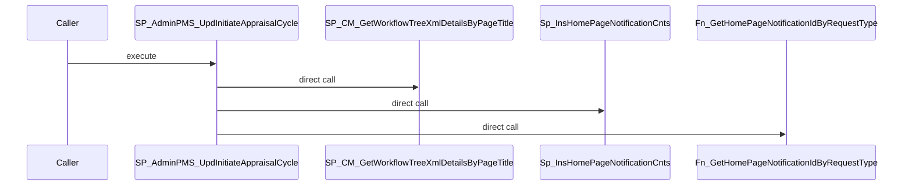
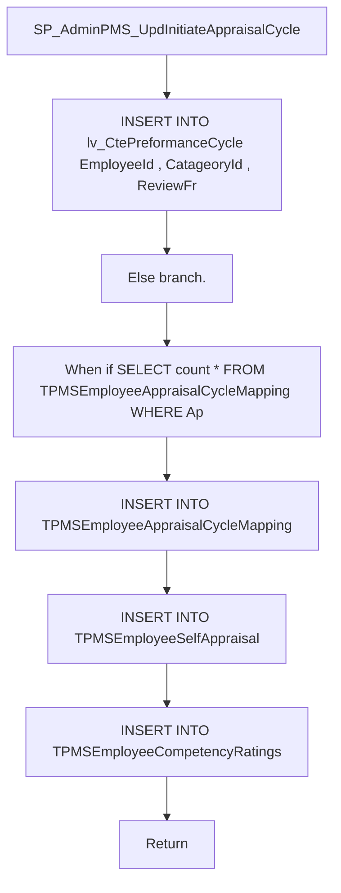

# SP_AdminPMS_UpdInitiateAppraisalCycle

## What it does

Stored procedure `SP_AdminPMS_UpdInitiateAppraisalCycle`. Writes `TPMSEmployeeAppraisalCycleMapping`, `TPMSEmployeeSelfAppraisal`, `TPMSEmployeeCompetencyRatings`, `TRequestWorkflows`, `TPMS_AssessmentEmployeeAllUpdates`, `TPMS_ParkWhatsAppAssessmentMapping`, `TPMS_AppraisalReviewFrequency`, `TPMSAppraisalCycles`, and others. Reads `tpms_appraisalreviewsequence`, `tpmsemployeegoalmapping`, `temployeeinfo`, `TEmployee`, `TPMSEmployerConfiguration`, `TPMS_AssesmentGoalReviewFrequencies`, `tResignationDetails`, `TSeparationType`, and others. Calls `SP_CM_GetWorkflowTreeXmlDetailsByPageTitle`, `Sp_InsHomePageNotificationCnts`, `Fn_GetHomePageNotificationIdByRequestType`.

## Parameters

| Name | Direction | What it is for |
|---|---|---|
| `@AppraisalCycleID` | in | Int |
| `@Employerid` | in | Int |
| `@InitiatedBy` | in | Int |

## Call sequence

## Callers

No other procedure or function calls this object.

## Nested

| Object | Kind | When | Page |
|---|---|---|---|
| `SP_CM_GetWorkflowTreeXmlDetailsByPageTitle` | procedure | direct call | [SP_CM_GetWorkflowTreeXmlDetailsByPageTitle](/docs/database/hrms/SP_CM_GetWorkflowTreeXmlDetailsByPageTitle) |
| `Sp_InsHomePageNotificationCnts` | procedure | direct call | [Sp_InsHomePageNotificationCnts](/docs/database/hrms/Sp_InsHomePageNotificationCnts) |
| `Fn_GetHomePageNotificationIdByRequestType` | function | direct call | [Fn_GetHomePageNotificationIdByRequestType](/docs/database/hrms/Fn_GetHomePageNotificationIdByRequestType) |

## Steps

1. Script is `HRMS-DATABASE/HRMS/STOREPROCEDURE/SP_AdminPMS_UpdInitiateAppraisalCycle.sql`.
2. INSERT INTO @lv_CtePreformanceCycle (EmployeeId , CatageoryId , ReviewFrequencyId , GoalSettingId , ReviewSequence , GoalRFId )
3. Else branch.
4. When if(((SELECT count(*) FROM TPMSEmployeeAppraisalCycleMapping WHERE AppraisalCycleId = @AppraisalCycleid AND Employeeid =@lv_Employeeid)=0))
5. INSERT INTO TPMSEmployeeAppraisalCycleMapping (
6. INSERT INTO TPMSEmployeeSelfAppraisal (
7. INSERT INTO TPMSEmployeeCompetencyRatings (
8. When if(((SELECT count(*) FROM TPMSEmployeeSelfAppraisal WHERE AppraisalCycleId = @AppraisalCycleid AND Employeeid =@lv_Employeeid and ReviewFrequncyId=@lv_ReviewFre
9. INSERT INTO TPMSEmployeeSelfAppraisal (
10. INSERT INTO TPMSEmployeeCompetencyRatings (
11. When if(@lv_ReviewSequence!='Employee')
12. insert into @WorkFlowTable(WorkflowId, WorkflowDefinitionTree, SkipWorkFlow)
13. Exec SP_CM_GetWorkflowTreeXmlDetailsByPageTitle 'SelfAssessment',@lv_tempEmpId,@lv_Employeeid
14. Delete from @WorkFlowTable
15. INSERT INTO @lv_MgrId(ManagerId)
16. DELETE FROM @WorkFlowTable
17. INSERT INTO TRequestWorkflows (RequestTransid, RequestType, ManagerId, WorkflowId, ApprovalLevel, IsApprove, ApproveStatus, CreatedBy, CreatedDate, RequestForEmployee)
18. EXEC [dbo].[Sp_InsHomePageNotificationCnts] @lv_ManagerId
19. When if(select count(*) from TPMS_AppraisalReviewFrequency where AppraisalCycleId = @AppraisalCycleID and ReviewFrequencyId=@ReviewFrequencyId and status ='Initiated
20. update TPMS_AppraisalReviewFrequency
21. Update TPMSAppraisalCycles
22. INSERT INTO TPMS_AssessmentEmployeeAllUpdates(TransId,AppraisalFormId,AppraisalCycleId,ReviewFrequencyId,
23. When if((Select IsSelfassessmentIsRequired from TPMSEmployerConfiguration where EmployerId=@Employerid)>0)
24. INSERT INTO TPMS_ParkWhatsAppAssessmentMapping(Module,Action,AppraisalCycleId,GoalSettingId,ConfirmationId,TransId, EmployeeId,EmployerId,CreatedBy,IsSelfassessmentIsRequired,Routi
25. Else branch.
26. INSERT INTO TPMS_ParkWhatsAppAssessmentMapping(Module,Action,AppraisalCycleId,GoalSettingId,ConfirmationId,TransId, EmployeeId,EmployerId,CreatedBy,IsSelfassessmentIsRequired,Routi
27. INSERT INTO TPMS_AssessmentEmployeeAllUpdates(TransId,AppraisalFormId,AppraisalCycleId,ReviewFrequencyId,

## Tables

| Table | Read or write |
|---|---|
| `FROM` | write |
| `TEMPLOYEE` | read |
| `TEmployee` | read |
| `TEmployeeOrgBusinessHead` | read |
| `TORGChart` | read |
| `TPMSAppraisalCycles` | write |
| `TPMSCategoryCompetencies` | read |
| `TPMSCategoryMaster` | read |
| `TPMSCategorySections` | read |
| `TPMSEmployeeAppraisalCycleMapping` | read and write |
| `TPMSEmployeeCompetencyRatings` | write |
| `TPMSEmployeeGoalFormData` | read |
| `TPMSEmployeeGoalFormDataDetails` | read |
| `TPMSEmployeeSelfAppraisal` | read and write |
| `TPMSEmployerConfiguration` | read |
| `TPMS_AppraisalReviewFrequency` | read and write |
| `TPMS_AssesmentGoalReviewFrequencies` | read |
| `TPMS_AssessmentEmployeeAllUpdates` | write |
| `TPMS_ParkWhatsAppAssessmentMapping` | write |
| `TRequestWorkflows` | read and write |
| `TSeparationType` | read |
| `Temployeeinfo` | read |
| `from` | write |
| `tResignationDetails` | read |
| `temployeeinfo` | read |
| `torgchart` | read |
| `tpms_appraisalreviewsequence` | read |
| `tpmsappraisalcycles` | read |
| `tpmsemployeegoalmapping` | read |
| `trolebusinessunitmapping` | read |
| `troleemployeemapping` | read |
| `trolelocationmapping` | read |
| `tworkflowdetails` | read |

## Flow

