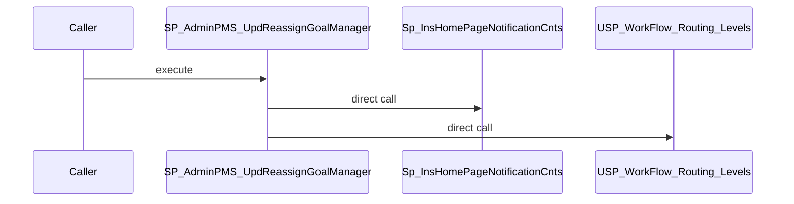
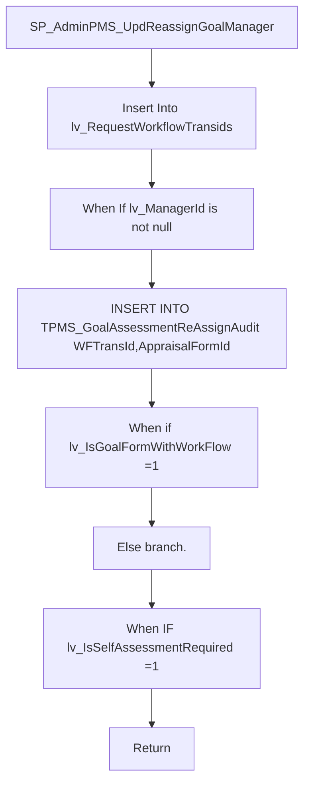

# SP_AdminPMS_UpdReassignGoalManager

## What it does

Stored procedure `SP_AdminPMS_UpdReassignGoalManager`. Writes `TPMS_GoalAssessmentReAssignAudit`, `TRequestWorkflows`, `TEmailNotification`, `tpmsemployeegoalmapping`. Reads `THomepageNotifications`, `Temployee`, `TPMSEmployerConfiguration`, `TWorkflowManagement`, `TEmailTemplates`, `TPMSEmployeeGoalMapping`, `TworkflowManagement`, `TPMSEmployeeGoalSettingReviewLevel`, and others. Calls `Sp_InsHomePageNotificationCnts`, `USP_WorkFlow_Routing_Levels`.

## Parameters

| Name | Direction | What it is for |
|---|---|---|
| `@MappingDetailsDetails` | in | Varchar(Max) |
| `@NewManagerId` | in | Int |
| `@CreatedBy` | in | Int |

## Call sequence

## Callers

No other procedure or function calls this object.

## Nested

| Object | Kind | When | Page |
|---|---|---|---|
| `Sp_InsHomePageNotificationCnts` | procedure | direct call | [Sp_InsHomePageNotificationCnts](/docs/database/hrms/Sp_InsHomePageNotificationCnts) |
| `USP_WorkFlow_Routing_Levels` | procedure | direct call | [USP_WorkFlow_Routing_Levels](/docs/database/hrms/USP_WorkFlow_Routing_Levels) |

## Steps

1. Script is `HRMS-DATABASE/HRMS/STOREPROCEDURE/SP_AdminPMS_UpdReassignGoalManager.sql`.
2. Insert Into @lv_RequestWorkflowTransids
3. When If @lv_ManagerId is not null
4. INSERT INTO TPMS_GoalAssessmentReAssignAudit(WFTransId,AppraisalFormId,GoalSettingId,EmployerId,OldManagerId,NewManagerId,MappingTranIdDetails,CreatedBy,CreatedDate, REASSIGNEDLEVE
5. When if(@lv_IsGoalFormWithWorkFlow =1)
6. Else branch.
7. When IF @lv_IsSelfAssessmentRequired =1
8. When if(len(@lv_tempRempLevel)>10)
9. Exec [dbo].[Sp_InsHomePageNotificationCnts] @lv_ManagerId,@Employerid,-1,0,@Lv_HomePagaNotificationId,'EmployeeGoalSetting',@lv_Transid,'SP_UpdatePMSReassignManager','Manager Chang
10. Exec [dbo].[Sp_InsHomePageNotificationCnts] @NewManagerId,@Employerid,1,0,@Lv_HomePagaNotificationId,'EmployeeGoalSetting',@lv_Transid,'SP_UpdatePMSReassignManager','Manager Change
11. When If(Select count(1) From TRequestWorkflows Where RequestTransid =@lv_RequestTransId and RequestType='EmployeeGoalSetting' and ManagerId=@NewManagerId)>0
12. When If (@lv_RoutingLevel=@lv_WFLevel)
13. Delete from TRequestWorkflows Where RequestTransid =@lv_Transid And RequestType='EmployeeGoalSetting' and ApprovalLevel=@lv_RoutingLevel
14. Update tpmsemployeegoalmapping
15. Else branch.
16. INSERT INTO #Managers
17. EXEC [dbo].[USP_WorkFlow_Routing_Levels] @wfId = @wfId
18. When IF (@lv_IsGoalFormWithWorkFlow)=1
19. UPDATE TRequestWorkflows
20. INSERT INTO dbo.TRequestWorkflows (
21. Update tpmsemployeegoalmapping
22. Else branch.
23. UPDATE TRequestWorkflows
24. INSERT INTO dbo.TRequestWorkflows (
25. When if(@lv_tempRempLevel ='ReviewLevel1')
26. Update tpmsemployeegoalmapping
27. Else branch.
28. Update tpmsemployeegoalmapping
29. Else branch.
30. Further statements continue in the script.

## Tables

| Table | Read or write |
|---|---|
| `TEmailNotification` | write |
| `TEmailTemplates` | read |
| `TEmployee` | read |
| `THomepageNotifications` | read |
| `TPMSEmployeeGoalMapping` | read |
| `TPMSEmployeeGoalSettingReviewLevel` | read |
| `TPMSEmployerConfiguration` | read |
| `TPMS_GoalAssessmentReAssignAudit` | write |
| `TRequestWorkflows` | read and write |
| `TWorkflowManagement` | read |
| `Temployee` | read |
| `TworkflowManagement` | read |
| `tpmsemployeegoalmapping` | read and write |

## Flow

