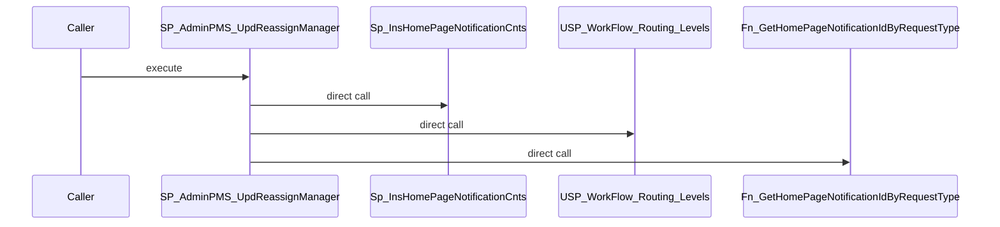
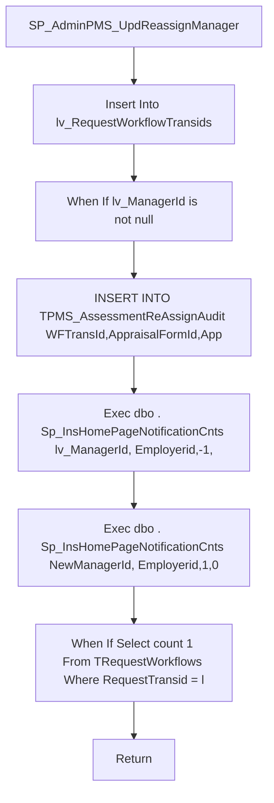

# SP_AdminPMS_UpdReassignManager

## What it does

Stored procedure `SP_AdminPMS_UpdReassignManager`. Writes `TPMS_AssessmentReAssignAudit`, `TPMS_AssessmentEmployeeAllUpdates`, `TRequestWorkflows`, `TPMSEmployeeSelfAppraisal`. Reads `Temployee`, `trequestworkflows`, `tpmsEmployeeSelfAppraisal`, `TworkflowManagement`, `TEmployee`. Calls `Sp_InsHomePageNotificationCnts`, `USP_WorkFlow_Routing_Levels`, `Fn_GetHomePageNotificationIdByRequestType`.

## Parameters

| Name | Direction | What it is for |
|---|---|---|
| `@MappingDetailsDetails` | in | Varchar(Max) |
| `@NewManagerId` | in | Int |
| `@CreatedBy` | in | Int |

## Call sequence

## Callers

No other procedure or function calls this object.

## Nested

| Object | Kind | When | Page |
|---|---|---|---|
| `Sp_InsHomePageNotificationCnts` | procedure | direct call | [Sp_InsHomePageNotificationCnts](/docs/database/hrms/Sp_InsHomePageNotificationCnts) |
| `USP_WorkFlow_Routing_Levels` | procedure | direct call | [USP_WorkFlow_Routing_Levels](/docs/database/hrms/USP_WorkFlow_Routing_Levels) |
| `Fn_GetHomePageNotificationIdByRequestType` | function | direct call | [Fn_GetHomePageNotificationIdByRequestType](/docs/database/hrms/Fn_GetHomePageNotificationIdByRequestType) |

## Steps

1. Script is `HRMS-DATABASE/HRMS/STOREPROCEDURE/SP_AdminPMS_UpdReassignManager.sql`.
2. Insert Into @lv_RequestWorkflowTransids
3. When If @lv_ManagerId is not null
4. INSERT INTO TPMS_AssessmentReAssignAudit(WFTransId,AppraisalFormId,AppraisalCycleId,EmployerId,OldManagerId,NewManagerId,MappingTranIdDetails,CreatedBy,CreatedDate, REASSIGNEDLEVEL
5. Exec [dbo].[Sp_InsHomePageNotificationCnts] @lv_ManagerId,@Employerid,-1,0,@Lv_HomePagaNotificationId,'SelfAssessment',@lv_Transid,'SP_UpdatePMSReassignManager','Manager Changed fo
6. Exec [dbo].[Sp_InsHomePageNotificationCnts] @NewManagerId,@Employerid,1,0,@Lv_HomePagaNotificationId,'SelfAssessment',@lv_Transid,'SP_UpdatePMSReassignManager','Manager Changed for
7. When If(Select count(1) From TRequestWorkflows Where RequestTransid =@lv_RequestTransId and RequestType='SelfAssessment' AND ApprovalLevel<@lv_RoutingLevel and Manag
8. When If (@lv_RoutingLevel=@lv_WFLevel)
9. INSERT INTO TPMS_AssessmentEmployeeAllUpdates(TransId,AppraisalFormId,AppraisalCycleId,ReviewFrequencyId,
10. Delete from TRequestWorkflows Where RequestTransid =@lv_RequestTransId And RequestType='SelfAssessment' and ApprovalLevel=@lv_RoutingLevel
11. UPDATE TPMSEmployeeSelfAppraisal
12. Else branch.
13. INSERT INTO #Managers
14. EXEC [dbo].[USP_WorkFlow_Routing_Levels] @wfId = @wfId
15. UPDATE TRequestWorkflows
16. INSERT INTO dbo.TRequestWorkflows (
17. INSERT INTO TPMS_AssessmentEmployeeAllUpdates(TransId,AppraisalFormId,AppraisalCycleId,ReviewFrequencyId,
18. Else branch.
19. INSERT INTO TPMS_AssessmentEmployeeAllUpdates(TransId,AppraisalFormId,AppraisalCycleId,ReviewFrequencyId,
20. Update TRequestWorkflows

## Tables

| Table | Read or write |
|---|---|
| `TEmployee` | read |
| `TPMSEmployeeSelfAppraisal` | read and write |
| `TPMS_AssessmentEmployeeAllUpdates` | write |
| `TPMS_AssessmentReAssignAudit` | write |
| `TRequestWorkflows` | read and write |
| `Temployee` | read |
| `TworkflowManagement` | read |
| `tpmsEmployeeSelfAppraisal` | read |
| `trequestworkflows` | read |

## Flow

