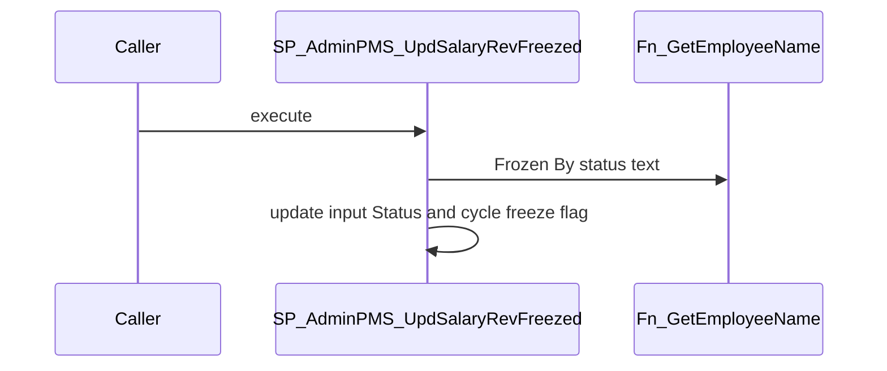
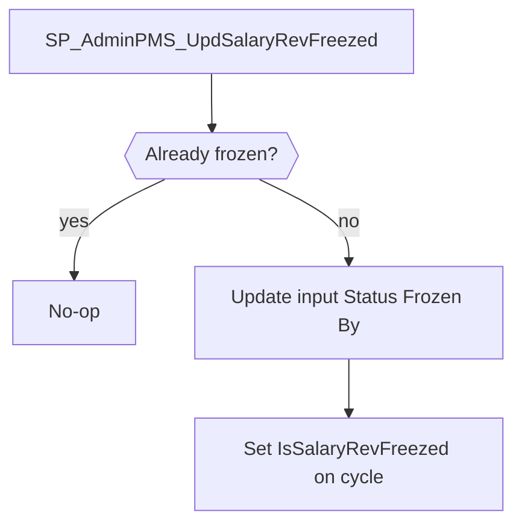

# SP_AdminPMS_UpdSalaryRevFreezed

## What it does

Freezes salary recommendations for an appraisal cycle when `IsSalaryRevFreezed` is not already set. Updates all `TPMSSalaryRevInputForEmployeeAssessment` Status to “Frozen By …” (using the cycle’s `InitiatedBy` name) and sets `TPMSAppraisalCycles.IsSalaryRevFreezed = 1` with `ModifiedBy` / timestamp for the matching employer.

## Parameters

| Name | Direction | What it is for |
|---|---|---|
| `@AppraisalCycleID` | in | Cycle to freeze |
| `@Employerid` | in | Employer owning the cycle |
| `@FreezedBy` | in | Actor writing ModifiedBy |

## Call sequence

## Callers

No other procedure or function calls this object. `performanceAssessmentDAL.UpdSalaryRevFreezed` executes it after a Save on Freeze.

## Nested

| Object | Kind | When | Page |
|---|---|---|---|
| `Fn_GetEmployeeName` | function | Frozen By status | [Fn_GetEmployeeName](/docs/database/hrms/Fn_GetEmployeeName) |

## Steps

1. Script is `HRMS-DATABASE/HRMS/STOREPROCEDURE/SP_AdminPMS_UpdSalaryRevFreezed.sql`.
2. If cycle already frozen, do nothing.
3. Else update input Status strings and set `IsSalaryRevFreezed` on the cycle for `@Employerid`.

## Tables

| Table | Read or write |
|---|---|
| `TPMSAppraisalCycles` | read/write |
| `TPMSSalaryRevInputForEmployeeAssessment` | write |
| `TEmployeeInfo` | read |

## Flow

