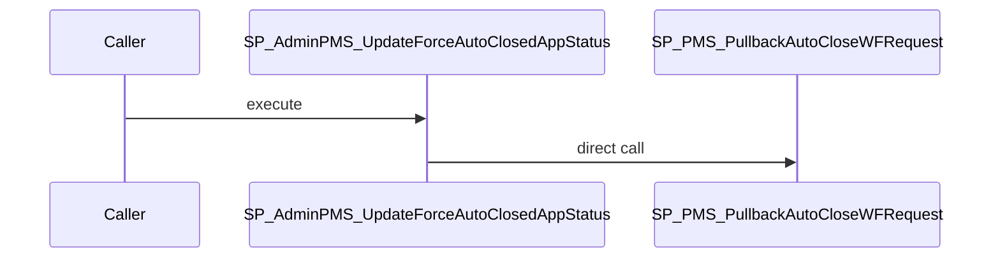
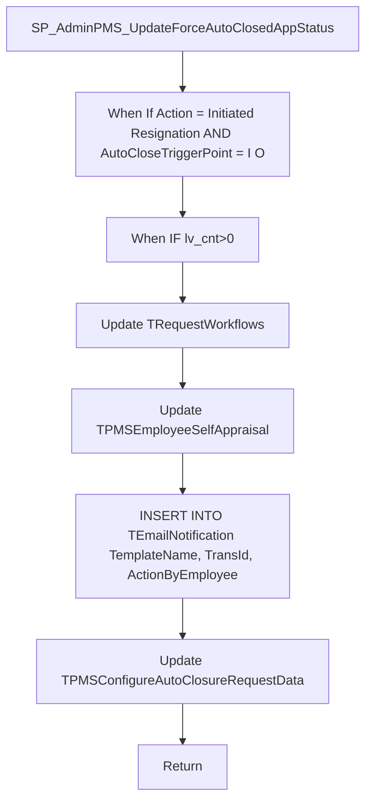

# SP_AdminPMS_UpdateForceAutoClosedAppStatus

## What it does

Stored procedure `SP_AdminPMS_UpdateForceAutoClosedAppStatus`. Writes `TEmailNotification`, `TRequestWorkflows`, `TPMSEmployeeSelfAppraisal`, `TPMSConfigureAutoClosureRequestData`, `TPMS_EmployeeAutoCloseRequest`. Reads `TPMSAppraisalCycles`, `TResignationDetails`, `tworkflowmanagement`, `TPMSEmployerConfiguration`. Calls `SP_PMS_PullbackAutoCloseWFRequest`.

## Parameters

| Name | Direction | What it is for |
|---|---|---|
| `@SelfAssessmentTransId` | in | int |
| `@Employeeid` | in | int |
| `@CycleId` | in | int |
| `@Comments` | in | varchar(100) |
| `@UpdatedBy` | in | int |
| `@ReviewFrequncyId` | in | int, default 0 |
| `@ResignationDetailId` | in | int, default 0 |
| `@ResignationId` | in | int, default 0 |
| `@Action` | in | varchar(100) |
| `@AutoCloseTriggerPoint` | in | varchar(1), default 'I' |
| `@IsReopenFormOnResignationPullback` | in | bit |
| `@ReopenFormTriggerPoint` | in | varchar(1) |
| `@ReopenFormBehavior` | in | varchar(1) |
| `@ReopenMode` | in | varchar(1) |

## Call sequence

## Callers

No other procedure or function calls this object.

## Nested

| Object | Kind | When | Page |
|---|---|---|---|
| `SP_PMS_PullbackAutoCloseWFRequest` | procedure | direct call | [SP_PMS_PullbackAutoCloseWFRequest](/docs/database/hrms/SP_PMS_PullbackAutoCloseWFRequest) |

## Steps

1. Script is `HRMS-DATABASE/HRMS/STOREPROCEDURE/SP_AdminPMS_UpdateForceAutoClosedAppStatus.sql`.
2. When If((@Action = 'Initiated Resignation' AND @AutoCloseTriggerPoint ='I') OR (@Action = 'Approved Resignation' AND @AutoCloseTriggerPoint ='A' AND (select count(1)
3. When IF @lv_cnt>0
4. Update TRequestWorkflows
5. Update TPMSEmployeeSelfAppraisal
6. INSERT INTO TEmailNotification (TemplateName, TransId, ActionByEmployeeID, RequestOwnerEmployeeID, Employerid, ActionName, wfID, CreatedBy, CreatedDate, UpdatedBy, Updatedate, Stat
7. Update TPMSConfigureAutoClosureRequestData
8. Update TPMS_EmployeeAutoCloseRequest
9. When If((@Action = 'Approved Resignation' AND @AutoCloseTriggerPoint ='A' AND (select count(1) from TResignationDetails where ResignationDetailId =@ResignationDetail
10. Update TPMS_EmployeeAutoCloseRequest
11. Update TPMSConfigureAutoClosureRequestData
12. When If(@IsReopenFormOnResignationPullback=0 AND @Action in ( 'Initiated Pullback', 'Pullback Resignation'))
13. Update TPMSConfigureAutoClosureRequestData
14. Update TPMS_EmployeeAutoCloseRequest
15. When If(@IsReopenFormOnResignationPullback=1 AND @Action in ( 'Initiated Pullback', 'Pullback Resignation'))
16. When If((@ReopenFormTriggerPoint = 'A' AND (select count(1) from TResignationDetails where ResignationDetailId =@ResignationDetailId and ApproveStatus ='Approved')>0
17. EXEC
18. INSERT INTO TEmailNotification (TemplateName, TransId, ActionByEmployeeID, RequestOwnerEmployeeID, Employerid, ActionName, wfID, CreatedBy, CreatedDate, UpdatedBy, Updatedate, Stat
19. When If(@IsReopenFormOnResignationPullback =1 AND @ReopenFormTriggerPoint in ('I','A') AND @ReopenFormBehavior ='N' AND @lv_IsSelfassessmentIsRequired=1)
20. Else branch.
21. When If(@ReopenFormTriggerPoint = 'A' AND (select count(1) from TResignationDetails where ResignationDetailId =@ResignationDetailId and ApproveStatus ='Approved')=0)
22. When if(@RejectionReason ='Waiting for Resignation Pullback Approval')
23. Update TPMSConfigureAutoClosureRequestData
24. Update TPMS_EmployeeAutoCloseRequest
25. Else branch.
26. When IF(@tempCnt=0)
27. EXEC
28. INSERT INTO TEmailNotification (TemplateName, TransId, ActionByEmployeeID, RequestOwnerEmployeeID, Employerid, ActionName, wfID, CreatedBy, CreatedDate, UpdatedBy, Updatedate, Stat
29. Update TPMSConfigureAutoClosureRequestData
30. Further statements continue in the script.

## Tables

| Table | Read or write |
|---|---|
| `TEmailNotification` | write |
| `TPMSAppraisalCycles` | read |
| `TPMSConfigureAutoClosureRequestData` | write |
| `TPMSEmployeeSelfAppraisal` | read and write |
| `TPMSEmployerConfiguration` | read |
| `TPMS_EmployeeAutoCloseRequest` | write |
| `TRequestWorkflows` | read and write |
| `TResignationDetails` | read |
| `tworkflowmanagement` | read |

## Flow

