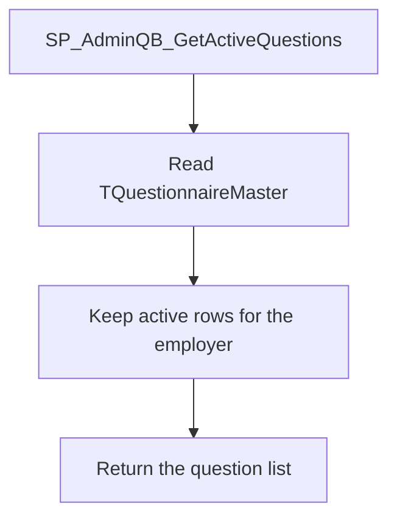

# SP_AdminQB_GetActiveQuestions

## What it does

Returns the active questionnaire rows for one organisation. The header comment says it gets active questionnaire details. A 25 September 2026 note adds `IsScoringEnabled` and `MaxScore` to the select list. The script drops the procedure and creates it again.

## Parameters

| Name | Direction | What it is for |
|---|---|---|
| `@Employerid` | in | Organisation whose questions are read |

## Call sequence

Calls no other procedures or functions.

## Callers

No other procedure or function calls this object.

`QuestionsAndTemplatesDAL.GetActiveQuestion` calls it from Assign Question Template. That caller is application code, not a procedure.

## Nested

Calls no other procedures or functions.

## Steps

1. Select `QuestionnaireId`, `QuestionnaireText`, `ControlType`, `IsScoringEnabled`, and `MaxScore` from `TQuestionnaireMaster` (`SP_AdminQB_GetActiveQuestions.sql`).
2. Keep rows where `IsActive = '1'` and `employerid` equals `@Employerid`.

`IsScoringEnabled` and `MaxScore` are not in `TABLES/TQuestionnaireMaster.sql`. They are added by `DDL/172253 _DDL_Statement.sql`.

## Tables

| Table | Read or write |
|---|---|
| `TQuestionnaireMaster` | read |

## Flow

