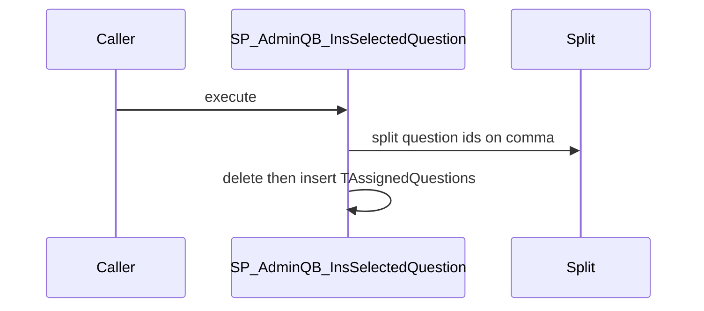
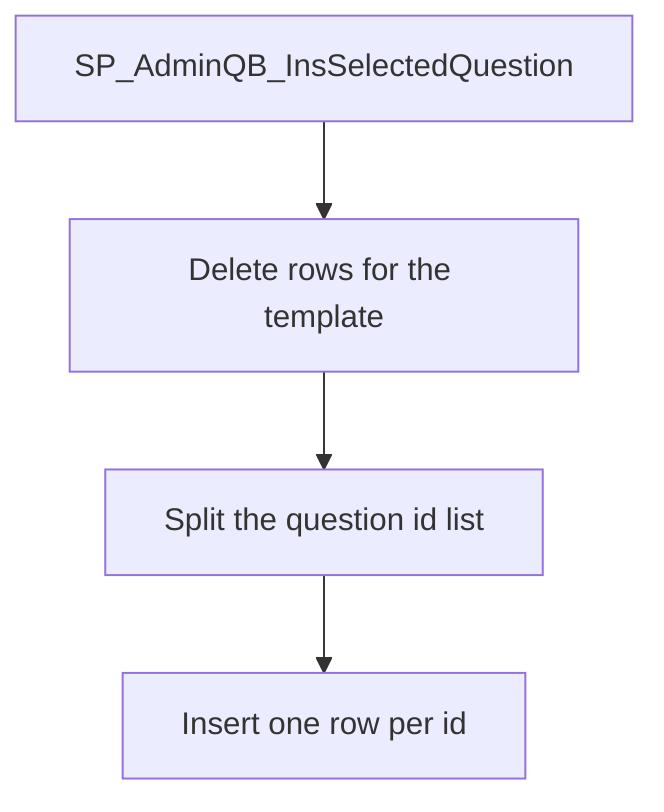

# SP_AdminQB_InsSelectedQuestion

## What it does

Replaces the question assignment for one template. It deletes every `TAssignedQuestions` row with that `TemplateId`, splits the comma-separated question ids, and inserts one row per id. The insert columns are `TemplateId`, `QuestionId`, `createdate`, and `createdby`. The script does not set `TemModCategoryId` and does not open a transaction.

## Parameters

| Name | Direction | What it is for |
|---|---|---|
| `@templateId` | in | Template whose assignment rows are replaced |
| `@questionId` | in | Comma-separated question ids, `nvarchar(max)` |
| `@Employeeid` | in | Stored in `createdby` |

## Call sequence

## Callers

No other procedure or function calls this object.

`QuestionsAndTemplatesDAL.InsertSelectedQuestion` calls it from Assign Question Template, inside a `TransactionScope`. That caller is application code, not a procedure.

## Nested

| Object | Kind | When | Page |
|---|---|---|---|
| `Split` | function | on every execute, to split `@questionId` | [Split](/docs/database/hrms/Split) |

## Steps

1. Delete from `TAssignedQuestions` where `TemplateId` equals `@templateId` (`SP_AdminQB_InsSelectedQuestion.sql`).
2. Insert `TemplateId`, `QuestionId`, `createdate` (`GetDate()`), and `createdby` (`@Employeeid`).
3. The question id for each new row is `data` from `dbo.Split(@questionId, ',')`.

`DDL/77539_Alter Statement for TAssignedQuestions.sql` adds nullable `TemModCategoryId` and `IsActive` with default 1. This insert does not mention either column.

## Tables

| Table | Read or write |
|---|---|
| `TAssignedQuestions` | write |

## Flow

