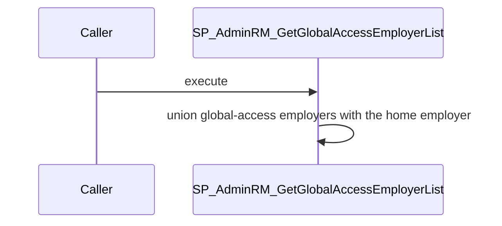
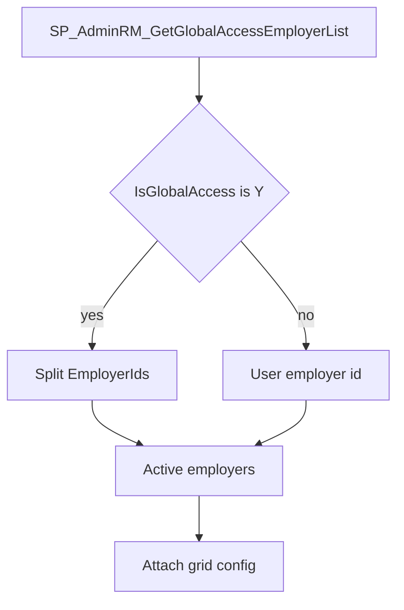

# SP_AdminRM_GetGlobalAccessEmployerList

## What it does

Returns the employers a user may choose in a global-access dropdown. Users with `IsGlobalAccess = 'Y'` get every active employer id in `TUsers.EmployerIds`. Everyone else gets their own employer. Each row also carries the saved employer-dropdown config for a grid, when one exists.

View Organization Chart uses the employer id and name to fill Select Organization. It does not apply `SelectedOrgs`. The client sends `gridId` as the text `null`, and the controller passes the token employee id rather than the query employee id.

## Parameters

| Name | Direction | What it is for |
|---|---|---|
| `@EmployeeId` | in | User whose access row is read |
| `@GridId` | in | Optional grid key for `TRRS_GRID_CONFIG`. Default null |

## Call sequence

Calls no other procedures or functions. `STRING_SPLIT` is the built-in splitter.

## Callers

| Object | Kind | Page |
|---|---|---|
| `recruitmentDAL.GetOrganizationList` | app | [View Organization Chart](/docs/guides/admin-configuration/view-organization-chart) via `GET /api/recruitment/getOrganizationList` |

No other file under `STOREPROCEDURE/` executes it. The live route is `RecruitmentRoutes.js`, which uses `recruitmentDAL.js`. V2 and V3 recruitment DAL files do not execute this name.

## Nested

None.

## Steps

In `HRMS-DATABASE/HRMS/STOREPROCEDURE/SP_AdminRM_GetGlobalAccessEmployerList.sql`:

1. For users with `IsGlobalAccess = 'Y'` and `TUserEmployee.EmployeeID = @EmployeeId`, split `TUsers.EmployerIds` and join `temployerdetails` where the employer is active (`IsActive` null or 1) and not deleted.
2. Union users whose global-access flag is `N` or null. That branch joins `TUsers.EmployerId` to the same active employer filter.
3. Both branches return `EmployerName`, `custid`, `Employerid`, `IsParentOrg`, and `SelectedOrgs`.
4. `IsParentOrg` is 1 when `ParentEmployerid = 0`, and 0 otherwise. The `ParentEmployerid = null` comparison does not match a null parent.
5. `SelectedOrgs` is the top `Config` from `TRRS_GRID_CONFIG` for this employee, `ConfigType = 'employerDropdown'`, and `GridId = @GridId`.

## Tables

| Table | Read or write |
|---|---|
| `dbo.tUsers` | read |
| `dbo.TUserEmployee` | read |
| `dbo.temployerdetails` | read |
| `dbo.TRRS_GRID_CONFIG` | read |

## Flow

