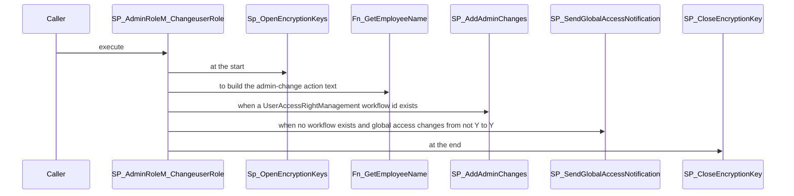
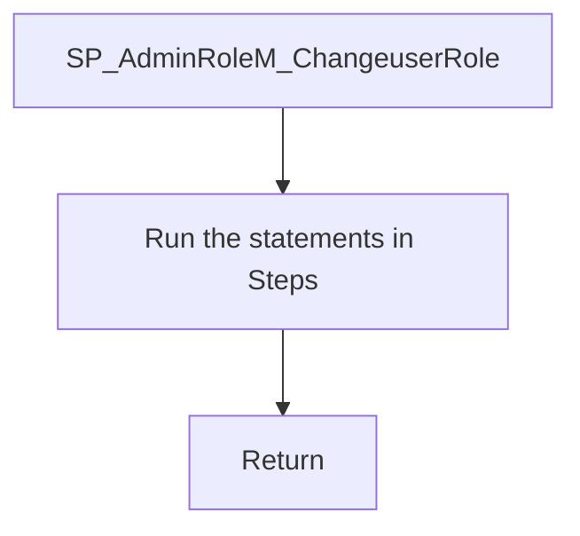

# SP_AdminRoleM_ChangeuserRole

## What it does

Assigns a role, report scope, and global-access employer list to one user. A workflow mapped to module page UserAccessRightManagement queues an UPDATE admin change on TUsers. Otherwise it archives the user row, updates TUsers, and queues a global-access email when global access flips to Y.

## Parameters

| Name | Direction | What it is for |
|---|---|---|
| `@userID` | in | User whose role changes |
| `@roleID` | in | New TUsers.RoleID |
| `@isGlobalAccess` | in | Yes or No. The procedure keeps the first character |
| `@UpdateBy` | in | Employee id stored as ModifiedBy |
| `@Employerid` | in | Employer on the user row and the workflow lookup |
| `@ReportingType` | in | Report-scope role id. No default in the script |
| `@EmployerIds` | in | Organizations for global access. Cleared when access is NO |

## Call sequence

## Callers

No other procedure or function calls this object.

## Nested

| Object | Kind | When | Page |
|---|---|---|
| `Sp_OpenEncryptionKeys` | procedure | at the start | [Sp_OpenEncryptionKeys](/docs/database/hrms/Sp_OpenEncryptionKeys) |
| `Fn_GetEmployeeName` | function | to build the admin-change action text | [Fn_GetEmployeeName](/docs/database/hrms/Fn_GetEmployeeName) |
| `SP_AddAdminChanges` | procedure | when a UserAccessRightManagement workflow id exists | [SP_AddAdminChanges](/docs/database/hrms/SP_AddAdminChanges) |
| `SP_SendGlobalAccessNotification` | procedure | when no workflow exists and global access changes from not Y to Y | [SP_SendGlobalAccessNotification](/docs/database/hrms/SP_SendGlobalAccessNotification) |
| `SP_CloseEncryptionKey` | procedure | at the end | [SP_CloseEncryptionKey](/docs/database/hrms/SP_CloseEncryptionKey) |

## Steps

1. Open encryption keys and build an action label from the employee name and employment number.
2. Read TWorkflowManagement.WorkflowId where MappedPages is the ModulePageId of UserAccessRightManagement, IsDelete is 0, and the employer matches.
3. Blank @EmployerIds when @isGlobalAccess is NO, then keep only the first character of @isGlobalAccess.
4. When a workflow id exists, execute SP_AddAdminChanges as an UPDATE of TUsers.
5. Otherwise insert the current TUsers row into TUsersHistory, update RoleID, IsGlobalAccess, ReportingType, and EmployerIds, and when global access becomes Y execute SP_SendGlobalAccessNotification.
6. Close encryption keys.

## Tables

| Table | Read or write |
|---|---|
| `TUsers` | read and write |
| `TUsersHistory` | write |
| `TEmployee` | read |
| `TEmployeeInfo` | read |
| `TuserEmployee` | read |
| `TWorkflowManagement` | read |
| `TModulePages` | read |

## Flow

