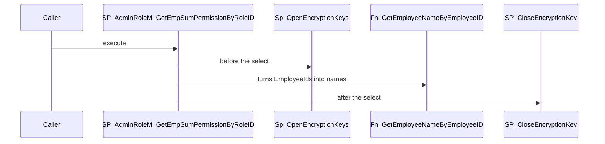
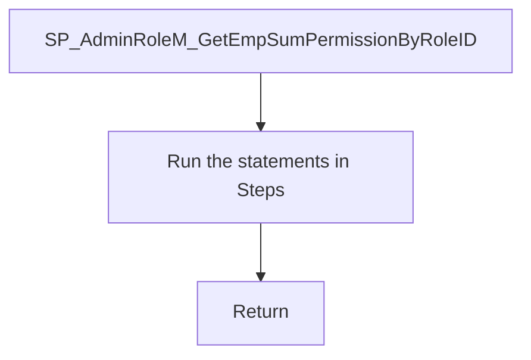

# SP_AdminRoleM_GetEmpSumPermissionByRoleID

## What it does

Returns Employee Summary tab rows for a role: menu, tab, active and inactive flags, employee names, and the stored employee id list.

## Parameters

| Name | Direction | What it is for |
|---|---|---|
| `@RoleId` | in | Role |
| `@EmployerID` | in | Employer on the tab grant |

## Call sequence

## Callers

No other procedure or function calls this object.

## Nested

| Object | Kind | When | Page |
|---|---|---|
| `Sp_OpenEncryptionKeys` | procedure | before the select | [Sp_OpenEncryptionKeys](/docs/database/hrms/Sp_OpenEncryptionKeys) |
| `Fn_GetEmployeeNameByEmployeeID` | function | turns EmployeeIds into names | [Fn_GetEmployeeNameByEmployeeID](/docs/database/hrms/Fn_GetEmployeeNameByEmployeeID) |
| `SP_CloseEncryptionKey` | procedure | after the select | [SP_CloseEncryptionKey](/docs/database/hrms/SP_CloseEncryptionKey) |

## Steps

1. Open encryption keys.
2. Join Tmenudetails, Ttabdetails, and troletabdetails where the tab name is Employee Summary and the role and employer match.
3. Look up flags, names, and employee ids from TRollWisePageAccess for the same menu, tab, role, and employer.
4. Close encryption keys.

## Tables

| Table | Read or write |
|---|---|
| `Tmenudetails` | read |
| `Ttabdetails` | read |
| `troletabdetails` | read |
| `TRollWisePageAccess` | read |

## Flow

