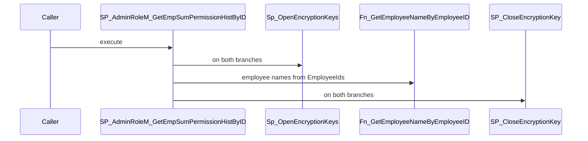
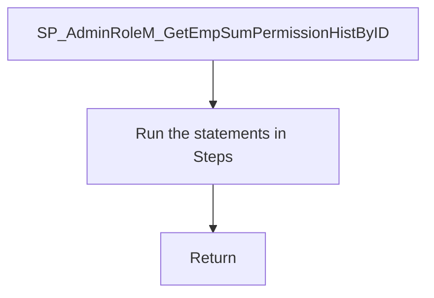

# SP_AdminRoleM_GetEmpSumPermissionHistByID

## What it does

Returns Employee Summary flags for a role. Transaction id 0 reads TRollWisePageAccess. Any other id reads TRollWisePageAccessHistory for that role-wise page id.

## Parameters

| Name | Direction | What it is for |
|---|---|---|
| `@RoleId` | in | Role |
| `@TransID` | in | 0 for the current rows, otherwise RoleWisePageId in history |
| `@Employerid` | in | Employer |

## Call sequence

## Callers

No other procedure or function calls this object.

## Nested

| Object | Kind | When | Page |
|---|---|---|
| `Sp_OpenEncryptionKeys` | procedure | on both branches | [Sp_OpenEncryptionKeys](/docs/database/hrms/Sp_OpenEncryptionKeys) |
| `Fn_GetEmployeeNameByEmployeeID` | function | employee names from EmployeeIds | [Fn_GetEmployeeNameByEmployeeID](/docs/database/hrms/Fn_GetEmployeeNameByEmployeeID) |
| `SP_CloseEncryptionKey` | procedure | on both branches | [SP_CloseEncryptionKey](/docs/database/hrms/SP_CloseEncryptionKey) |

## Steps

1. When @TransID is 0, open keys and select current TRollWisePageAccess rows for the role and employer.
2. Otherwise select TRollWisePageAccessHistory where rolewisepageid equals @TransID.
3. Look up tab name, menu name, role name, and employee names, then close keys.

## Tables

| Table | Read or write |
|---|---|
| `TRollWisePageAccess` | read |
| `TRollWisePageAccessHistory` | read |
| `ttabdetails` | read |
| `tmenudetails` | read |
| `TRoles` | read |

## Flow

