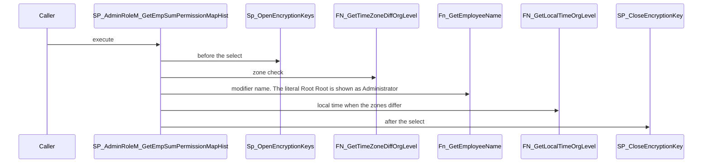
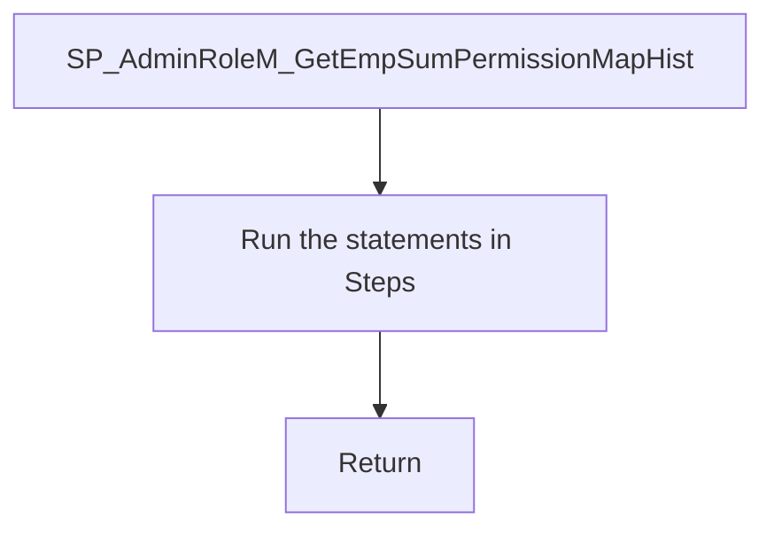

# SP_AdminRoleM_GetEmpSumPermissionMapHist

## What it does

Returns the distinct Employee Summary change events for a role, with the modifier name and a date shifted to the employer time zone when the server zone differs.

## Parameters

| Name | Direction | What it is for |
|---|---|---|
| `@RoleId` | in | Role |
| `@Employerid` | in | Employer and time-zone key |

## Call sequence

## Callers

No other procedure or function calls this object.

## Nested

| Object | Kind | When | Page |
|---|---|---|
| `Sp_OpenEncryptionKeys` | procedure | before the select | [Sp_OpenEncryptionKeys](/docs/database/hrms/Sp_OpenEncryptionKeys) |
| `FN_GetTimeZoneDiffOrgLevel` | function | zone check | [FN_GetTimeZoneDiffOrgLevel](/docs/database/hrms/FN_GetTimeZoneDiffOrgLevel) |
| `Fn_GetEmployeeName` | function | modifier name. The literal Root Root is shown as Administrator | [Fn_GetEmployeeName](/docs/database/hrms/Fn_GetEmployeeName) |
| `FN_GetLocalTimeOrgLevel` | function | local time when the zones differ | [FN_GetLocalTimeOrgLevel](/docs/database/hrms/FN_GetLocalTimeOrgLevel) |
| `SP_CloseEncryptionKey` | procedure | after the select | [SP_CloseEncryptionKey](/docs/database/hrms/SP_CloseEncryptionKey) |

## Steps

1. Open encryption keys and compare time zones.
2. Read current TRollWisePageAccess rows and history rows for the role.
3. Resolve the modifier from TEmployee and return distinct role, transaction, modifier, and date.
4. Close encryption keys.

## Tables

| Table | Read or write |
|---|---|
| `TRollWisePageAccess` | read |
| `TRollWisePageAccessHistory` | read |
| `TRoles` | read |
| `TEmployee` | read |

## Flow

