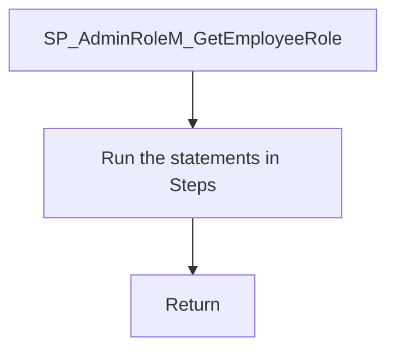

# SP_AdminRoleM_GetEmployeeRole

## What it does

Returns the role id and role name stored on one user for an employer. The header comment points this at the user-permission screen.

## Parameters

| Name | Direction | What it is for |
|---|---|---|
| `@UserId` | in | User id |
| `@EmployerID` | in | Employer on Tusers |

## Call sequence

Calls no other procedures or functions.

## Callers

No other procedure or function calls this object.

## Nested

Calls no other procedures or functions.

## Steps

1. Join Tusers to TRoles on RoleID and return roleid and RoleName for the user and employer.

## Tables

| Table | Read or write |
|---|---|
| `Tusers` | read |
| `TRoles` | read |

## Flow

