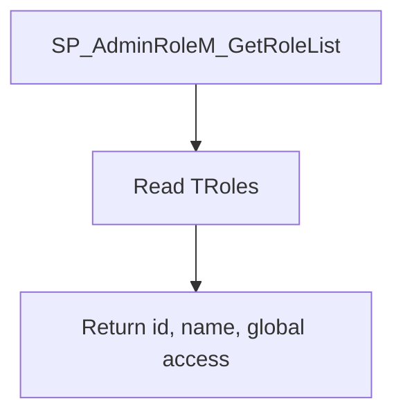

# SP_AdminRoleM_GetRoleList

## What it does

Returns RoleID, RoleName, and IsGlobalAccess for default roles of employer 0 or this employer, and for non-default roles of this employer, ordered by name.

## Parameters

| Name | Direction | What it is for |
|---|---|---|
| `@Employerid` | in | Employer whose roles fill the dropdown |

## Call sequence

Calls no other procedures or functions.

## Callers

No other procedure or function calls this object.

## Nested

Calls no other procedures or functions.

## Steps

1. Select RoleID, RoleName, and IsGlobalAccess from TRoles with the default-role employer rule, ordered by RoleName.

## Tables

| Table | Read or write |
|---|---|
| `TRoles` | read |

## Flow

