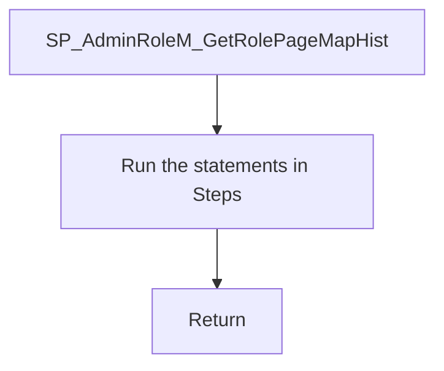

# SP_AdminRoleM_GetRolePageMapHist

## What it does

Returns the pages on a role. Transaction id 0 reads the current TRolePagesMapping rows. Any other id reads TRolePagesMappingHistory for that transaction.

## Parameters

| Name | Direction | What it is for |
|---|---|---|
| `@RoleId` | in | Role |
| `@TransID` | in | 0 for the current grant, otherwise a history transaction |
| `@Employerid` | in | Employer |

## Call sequence

Calls no other procedures or functions.

## Callers

No other procedure or function calls this object.

## Nested

Calls no other procedures or functions.

## Steps

1. When @TransID is 0, select RoleID, role name, and PageId from TRolePagesMapping.
2. Otherwise select the same columns from TRolePagesMappingHistory for that Transid, newest first.

## Tables

| Table | Read or write |
|---|---|
| `TRoles` | read |
| `TRolePagesMapping` | read |
| `TRolePagesMappingHistory` | read |

## Flow

