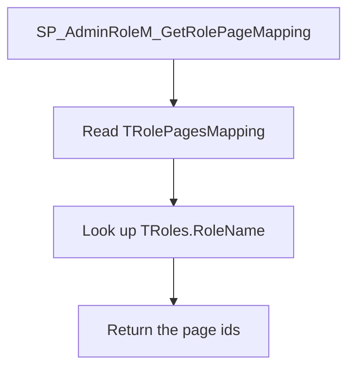

# SP_AdminRoleM_GetRolePageMapping

## What it does

Returns the menu page ids currently granted to a role, with the role name. Access Right Management reads this list when it keeps celebration-hub pages on an update and when it redraws the role page tree.

## Parameters

| Name | Direction | What it is for |
|---|---|---|
| `@RoleId` | in | Role whose pages are listed |
| `@Employerid` | in | Employer on `TRolePagesMapping` |

## Call sequence

Calls no other procedures or functions.

## Callers

No other procedure or function calls this object.

## Nested

Calls no other procedures or functions.

## Steps

1. Select `RoleID`, the role name from `TRoles`, and `PageId` from `TRolePagesMapping` for the role and employer (`SP_AdminRoleM_GetRolePageMapping.sql`).

## Tables

| Table | Read or write |
|---|---|
| `TRolePagesMapping` | read |
| `TRoles` | read |

## Flow

