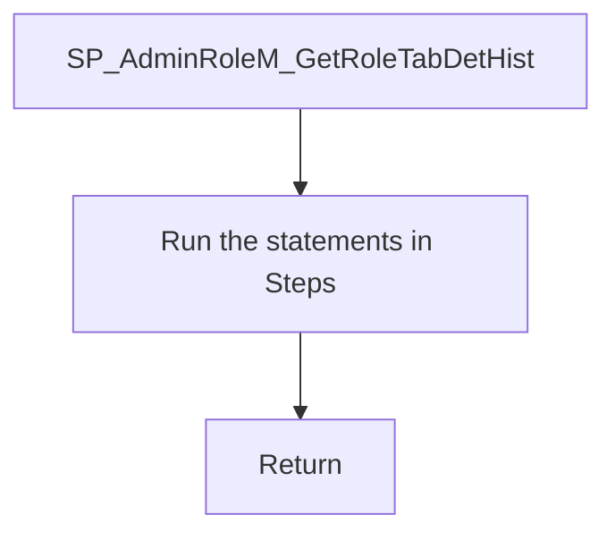

# SP_AdminRoleM_GetRoleTabDetHist

## What it does

Returns tab rights for a role. Transaction id 0 unions the current TRoleTabDetails rows with history. Any other id returns that history transaction only.

## Parameters

| Name | Direction | What it is for |
|---|---|---|
| `@RoleId` | in | Role |
| `@TransID` | in | 0 for current plus history, otherwise one transaction |
| `@Employerid` | in | Employer |

## Call sequence

Calls no other procedures or functions.

## Callers

No other procedure or function calls this object.

## Nested

Calls no other procedures or functions.

## Steps

1. When @TransID is 0, select current tab rows and union every history row for the role and employer.
2. Otherwise select TRoleTabDetailsHistory for that Transid.
3. Each row includes the tab name from ttabdetails, IsEditable, TabId, and MenuId.

## Tables

| Table | Read or write |
|---|---|
| `TRoleTabDetails` | read |
| `TRoleTabDetailsHistory` | read |
| `ttabdetails` | read |

## Flow

