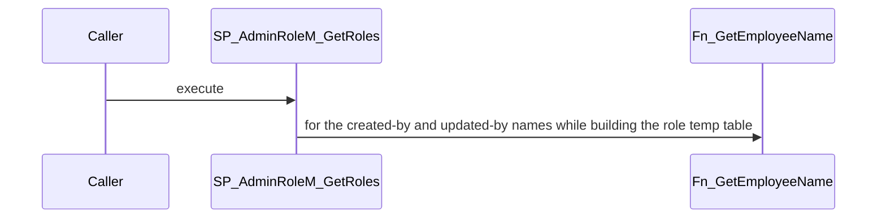
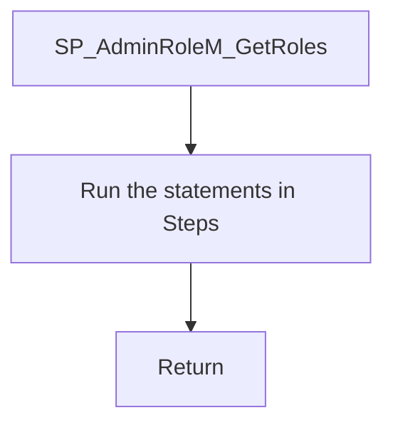

# SP_AdminRoleM_GetRoles

## What it does

Returns the active roles for an employer, including default roles stored for employer 0, plus the comma-separated page ids and the location and business-unit lists from TRolePagesMapping. The header comment describes this as the access-right role list.

## Parameters

| Name | Direction | What it is for |
|---|---|---|
| `@EmployerID` | in | Employer whose roles are listed |

## Call sequence

## Callers

No other procedure or function calls this object.

## Nested

| Object | Kind | When | Page |
|---|---|---|
| `Fn_GetEmployeeName` | function | for the created-by and updated-by names while building the role temp table | [Fn_GetEmployeeName](/docs/database/hrms/Fn_GetEmployeeName) |

## Steps

1. Select active default roles for employer 0 or this employer, and active non-default roles for this employer, into #Roles.
2. While building #Roles, map ReportingType 1, 3, and 4 to All, Team, and Self. The final select does not return that column.
3. Join TRolePagesMapping on role and @EmployerID, aggregate PageId, and return one row per role with LocationIds, BusinessUnitIds, PageIds, and RoleType.
4. The output column ReportingTypeName is the name of the role whose RoleID equals TRoles.ReportingType, not the All/Team/Self label.

## Tables

| Table | Read or write |
|---|---|
| `TRoles` | read |
| `TRolePagesMapping` | read |

## Flow

