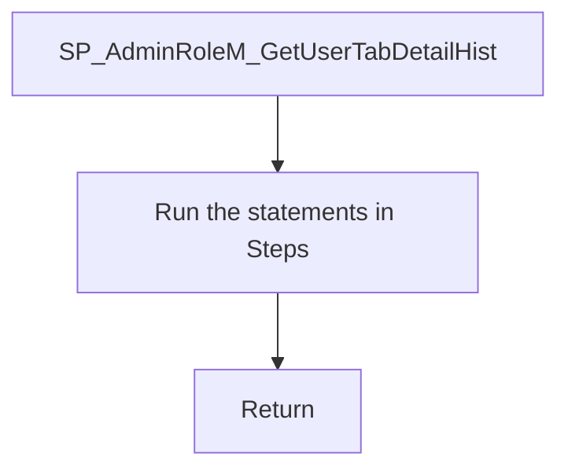

# SP_AdminRoleM_GetUserTabDetailHist

## What it does

Returns tab rights for one user. Transaction id 0 unions current TUserTabDetails with history. Any other id returns that history transaction.

## Parameters

| Name | Direction | What it is for |
|---|---|---|
| `@UserId` | in | User |
| `@TransID` | in | 0 for current plus history, otherwise one transaction |
| `@Employerid` | in | Employer |

## Call sequence

Calls no other procedures or functions.

## Callers

No other procedure or function calls this object.

## Nested

Calls no other procedures or functions.

## Steps

1. When @TransID is 0, union current user tabs with history.
2. Otherwise select TUserTabDetailsHistory for that Transid.
3. Look up TabName from ttabdetails.

## Tables

| Table | Read or write |
|---|---|
| `TUserTabDetails` | read |
| `TUserTabDetailsHistory` | read |
| `ttabdetails` | read |

## Flow

