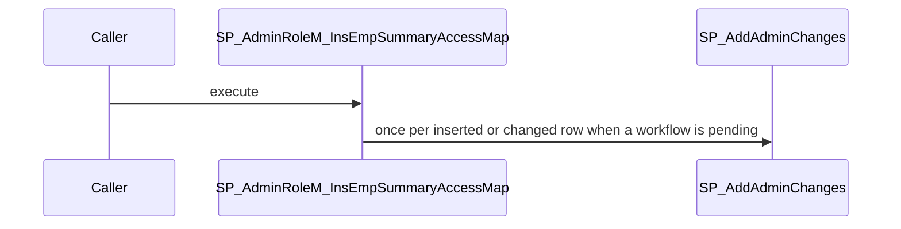
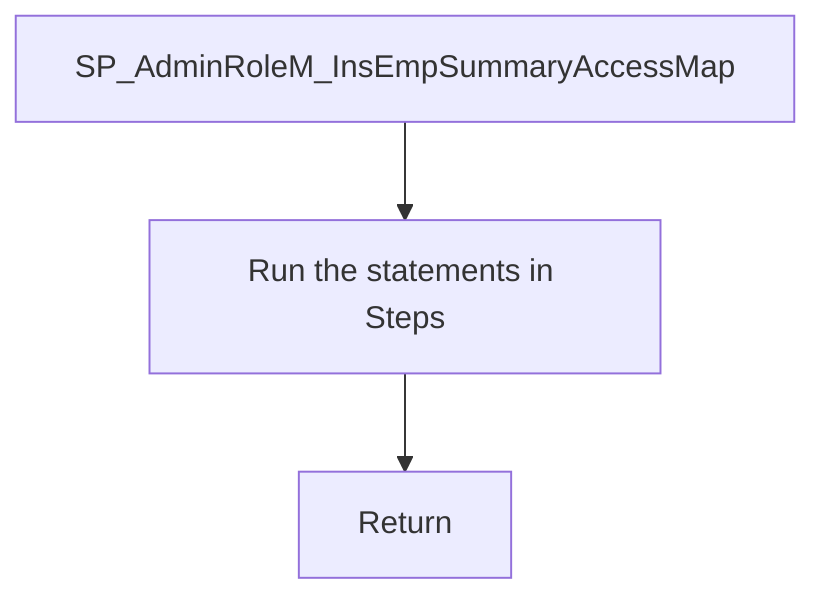

# SP_AdminRoleM_InsEmpSummaryAccessMap

## What it does

Saves which employees a role may see on Employee Summary, as active and inactive flags per menu and tab. A pending EmployeeSummaryPermissions workflow either rejects a second pending request or queues one admin change per changed row. With no workflow it archives and inserts or updates TRollWisePageAccess.

## Parameters

| Name | Direction | What it is for |
|---|---|---|
| `@RoleId` | in | Role the summary grant belongs to |
| `@CreatedBy` | in | Employee id. Values at or below 0 skip the workflow branch |
| `@Employerid` | in | Employer |
| `@EmployeeSummaryAccess` | in | Table-valued rows of MenuID, TabID, ActiveFlag, and InactiveFlag |
| `@EmployeeIds` | in | Employee id list stored on the grant |

## Call sequence

## Callers

No other procedure or function calls this object.

## Nested

| Object | Kind | When | Page |
|---|---|---|
| `SP_AddAdminChanges` | procedure | once per inserted or changed row when a workflow is pending | [SP_AddAdminChanges](/docs/database/hrms/SP_AddAdminChanges) |

## Steps

1. Read the workflow id for module page name EmployeeSummaryPermissions.
2. When a workflow exists and @CreatedBy is greater than 0, return an error if a pending TAdminChangesApprovals row already names this role for TRollWisePageAccess.
3. Walk @EmployeeSummaryAccess. A missing TRollWisePageAccess row queues an INSERT. A changed flag or employee list queues an UPDATE.
4. With no workflow, copy current rows into TRollWisePageAccessHistory, insert or update each menu/tab, stamp ModifiedDate, and delete summary rows whose employee list is empty.
5. When nothing changed, select error code 1 and the message Please Edit Atleast One Field.

## Tables

| Table | Read or write |
|---|---|
| `TRoles` | read |
| `TWorkflowManagement` | read |
| `TModulePages` | read |
| `TAdminChangesApprovals` | read |
| `TAdminChangesApprovalDetails` | read |
| `TRollWisePageAccess` | read and write |
| `TRollWisePageAccessHistory` | write |

## Flow

