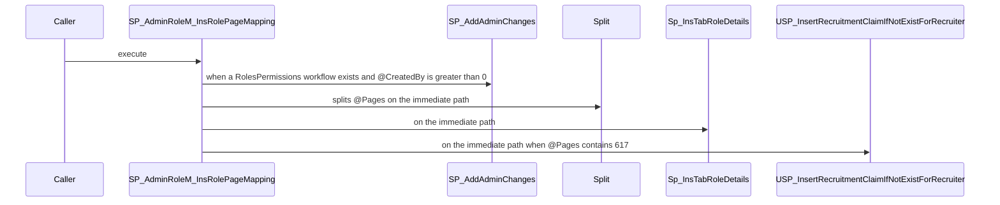
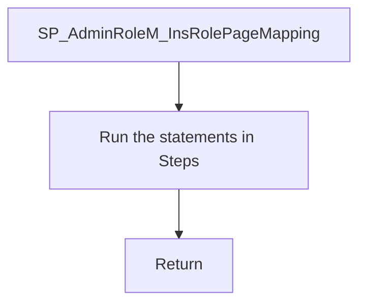

# SP_AdminRoleM_InsRolePageMapping

## What it does

Replaces a role's page and tab grants without updating TRoles. A RolesPermissions workflow queues one admin change. Otherwise it keeps the location and business-unit values already stored, replaces the page rows, and writes tabs.

## Parameters

| Name | Direction | What it is for |
|---|---|---|
| `@RoleId` | in | Role |
| `@Pages` | in | Comma-separated page ids |
| `@TabRightsDet` | in | Tab rights string |
| `@CreatedBy` | in | Creator. The workflow branch also requires this to be greater than 0 |
| `@Employerid` | in | Employer |

## Call sequence

## Callers

No other procedure or function calls this object.

## Nested

| Object | Kind | When | Page |
|---|---|---|
| `SP_AddAdminChanges` | procedure | when a RolesPermissions workflow exists and @CreatedBy is greater than 0 | [SP_AddAdminChanges](/docs/database/hrms/SP_AddAdminChanges) |
| `Split` | function | splits @Pages on the immediate path | [Split](/docs/database/hrms/Split) |
| `Sp_InsTabRoleDetails` | procedure | on the immediate path | [Sp_InsTabRoleDetails](/docs/database/hrms/Sp_InsTabRoleDetails) |
| `USP_InsertRecruitmentClaimIfNotExistForRecruiter` | procedure | on the immediate path when @Pages contains 617 | [USP_InsertRecruitmentClaimIfNotExistForRecruiter](/docs/database/hrms/USP_InsertRecruitmentClaimIfNotExistForRecruiter) |

## Steps

1. Build an action label from the role name and read the workflow for module page RolesPermissions.
2. When a workflow id exists and @CreatedBy is greater than 0, execute SP_AddAdminChanges for TRolePagesMapping,TRoleTabDetails.
3. Otherwise archive TRolePagesMapping, remember the current LocationIds and BusinessUnitIds, delete the rows, and insert the new pages with those same location and business-unit values.
4. Execute Sp_InsTabRoleDetails, and when page 617 is present execute the recruitment-claim procedure with RequestType Role.

## Tables

| Table | Read or write |
|---|---|
| `TRoles` | read |
| `TRolePagesMapping` | read and write |
| `TRolePagesMappingHistory` | write |
| `TWorkflowManagement` | read |
| `TModulePages` | read |
| `TRoleTabDetails` | write, through Sp_InsTabRoleDetails |

## Flow

