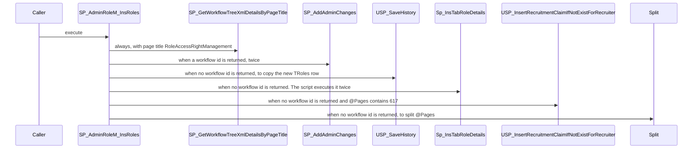
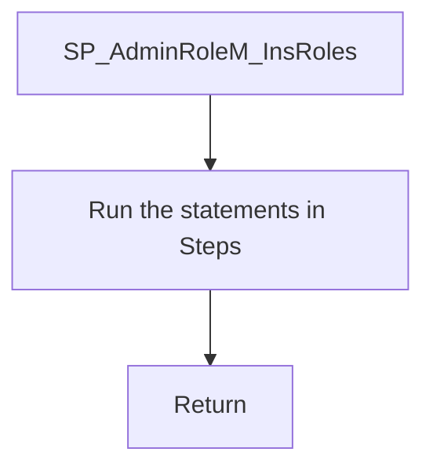

# SP_AdminRoleM_InsRoles

## What it does

Creates an access-right role and the menu pages and tabs that role may open. When a workflow is mapped to the page name RoleAccessRightManagement, it files two pending admin changes and does not insert the role. Otherwise it inserts TRoles, replaces TRolePagesMapping from the comma-separated page list, and writes tab rights.

## Parameters

| Name | Direction | What it is for |
|---|---|---|
| `@RoleName` | in | Role name written to TRoles.RoleName |
| `@CreatedBy` | in | Employee id stored as createdby |
| `@Employerid` | in | Employer the role belongs to |
| `@RoleDescription` | in | Role description |
| `@ReportingType` | in | Report-scope role id. Default null |
| `@Pages` | in | Comma-separated menu page ids |
| `@TabRightsDet` | in | Comma-separated MenuId~TabId~IsEditable values |
| `@LocationIds` | in | Comma-separated location ids. Empty becomes null |
| `@BusinessUnitIds` | in | Comma-separated business unit ids. Empty becomes null |
| `@RoleType` | in | Role type text |

## Call sequence

## Callers

No other procedure or function calls this object.

## Nested

| Object | Kind | When | Page |
|---|---|---|
| `SP_GetWorkflowTreeXmlDetailsByPageTitle` | procedure | always, with page title RoleAccessRightManagement | [SP_GetWorkflowTreeXmlDetailsByPageTitle](/docs/database/hrms/SP_GetWorkflowTreeXmlDetailsByPageTitle) |
| `SP_AddAdminChanges` | procedure | when a workflow id is returned, twice | [SP_AddAdminChanges](/docs/database/hrms/SP_AddAdminChanges) |
| `USP_SaveHistory` | procedure | when no workflow id is returned, to copy the new TRoles row | Script not in inventory |
| `Sp_InsTabRoleDetails` | procedure | when no workflow id is returned. The script executes it twice | [Sp_InsTabRoleDetails](/docs/database/hrms/Sp_InsTabRoleDetails) |
| `USP_InsertRecruitmentClaimIfNotExistForRecruiter` | procedure | when no workflow id is returned and @Pages contains 617 | [USP_InsertRecruitmentClaimIfNotExistForRecruiter](/docs/database/hrms/USP_InsertRecruitmentClaimIfNotExistForRecruiter) |
| `Split` | function | when no workflow id is returned, to split @Pages | [Split](/docs/database/hrms/Split) |

## Steps

1. Load a workflow id by executing SP_GetWorkflowTreeXmlDetailsByPageTitle for RoleAccessRightManagement and @Employerid.
2. When a workflow id is present, build role XML and page-mapping XML and execute SP_AddAdminChanges twice (INSERT into TRoles, then INSERT into TRolePagesMapping,TRoleTabDetails). Stop there.
3. When no workflow id is present, insert troles with IsDefault 0 and IsActive Y, then copy that new row through USP_SaveHistory into TRoles_History.
4. Copy any existing TRolePagesMapping rows for that role and employer into TRolePagesMappingHistory, delete them, and insert one row per value from dbo.Split(@Pages, ',').
5. Execute Sp_InsTabRoleDetails, and when @Pages contains 617 execute USP_InsertRecruitmentClaimIfNotExistForRecruiter with RequestType Role.
6. Execute Sp_InsTabRoleDetails a second time with the same arguments.

## Tables

| Table | Read or write |
|---|---|
| `TRoles` | write |
| `TRolePagesMapping` | read and write |
| `TRolePagesMappingHistory` | write |
| `TRoleTabDetails` | write, through Sp_InsTabRoleDetails |

## Flow

