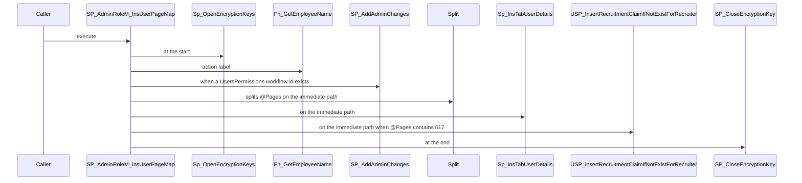
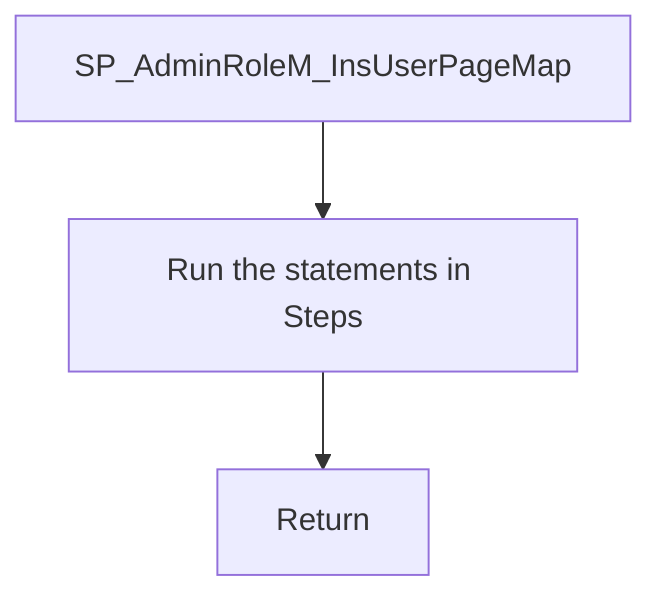

# SP_AdminRoleM_InsUserPageMap

## What it does

Replaces the extra menu pages and tabs granted to one user. A workflow whose mapped page is UsersPermissions queues an admin change. Otherwise it archives TUSerPagesMapping, inserts the new pages, writes tab rights, and seeds a recruitment claim when page 617 is included.

## Parameters

| Name | Direction | What it is for |
|---|---|---|
| `@Users` | in | User id |
| `@Pages` | in | Comma-separated page ids |
| `@TabRightsDet` | in | Comma-separated MenuId~TabId~IsEditable values |
| `@CreatedBy` | in | Employee id stored as the creator |
| `@Employerid` | in | Employer on the mapping |
| `@LocationIds` | in | Location ids. Empty becomes null |
| `@BusinessUnitIds` | in | Business unit ids. Empty becomes null |

## Call sequence

## Callers

No other procedure or function calls this object.

## Nested

| Object | Kind | When | Page |
|---|---|---|
| `Sp_OpenEncryptionKeys` | procedure | at the start | [Sp_OpenEncryptionKeys](/docs/database/hrms/Sp_OpenEncryptionKeys) |
| `Fn_GetEmployeeName` | function | action label | [Fn_GetEmployeeName](/docs/database/hrms/Fn_GetEmployeeName) |
| `SP_AddAdminChanges` | procedure | when a UsersPermissions workflow id exists | [SP_AddAdminChanges](/docs/database/hrms/SP_AddAdminChanges) |
| `Split` | function | splits @Pages on the immediate path | [Split](/docs/database/hrms/Split) |
| `Sp_InsTabUserDetails` | procedure | on the immediate path | [Sp_InsTabUserDetails](/docs/database/hrms/Sp_InsTabUserDetails) |
| `USP_InsertRecruitmentClaimIfNotExistForRecruiter` | procedure | on the immediate path when @Pages contains 617 | [USP_InsertRecruitmentClaimIfNotExistForRecruiter](/docs/database/hrms/USP_InsertRecruitmentClaimIfNotExistForRecruiter) |
| `SP_CloseEncryptionKey` | procedure | at the end | [SP_CloseEncryptionKey](/docs/database/hrms/SP_CloseEncryptionKey) |

## Steps

1. Open encryption keys, resolve the employee name, and read the user's current role id from Tusers.
2. Read the workflow id for module page name UsersPermissions.
3. When that id exists and the insert path is taken, execute SP_AddAdminChanges for TUSerPagesMapping,TUserTabDetails.
4. Otherwise archive TUSerPagesMapping into TUserPagesMappingHistory, delete the current rows, and insert one row per page from dbo.Split.
5. Execute Sp_InsTabUserDetails. When page 617 is present, resolve TUserEmployee.EmployeeID and execute USP_InsertRecruitmentClaimIfNotExistForRecruiter with RequestType Role.
6. Select ErrorCode 0 and an empty notification row, then close encryption keys.

## Tables

| Table | Read or write |
|---|---|
| `Tusers` | read |
| `TUserEmployee` | read |
| `TEmployee` | read |
| `TEmployeeInfo` | read |
| `TWorkflowManagement` | read |
| `TModulePages` | read |
| `TUSerPagesMapping` | write |
| `TUserPagesMappingHistory` | write |
| `TUserTabDetails` | write, through Sp_InsTabUserDetails |

## Flow

