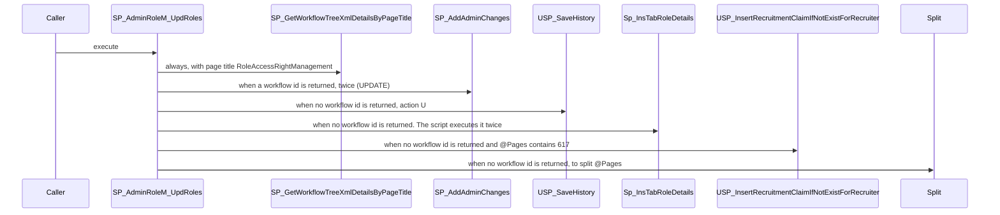
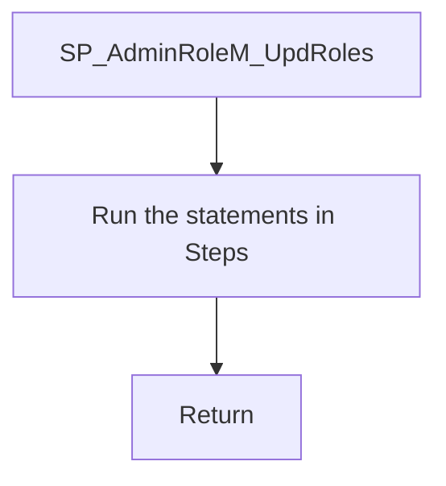

# SP_AdminRoleM_UpdRoles

## What it does

Updates an existing access-right role and replaces its page and tab grants. A mapped RoleAccessRightManagement workflow queues two admin changes instead of updating the tables.

## Parameters

| Name | Direction | What it is for |
|---|---|---|
| `@RoleId` | in | Role to update |
| `@RoleName` | in | New role name |
| `@CreatedBy` | in | Employee id stored as the updater |
| `@Employerid` | in | Employer scope for the page mapping |
| `@RoleDescription` | in | New description |
| `@ReportingType` | in | Report-scope role id. Default null |
| `@Pages` | in | Comma-separated menu page ids that replace the current grant |
| `@TabRightsDet` | in | Comma-separated MenuId~TabId~IsEditable values |
| `@LocationIds` | in | Location ids. Empty becomes null |
| `@BusinessUnitIds` | in | Business unit ids. Empty becomes null |
| `@RoleType` | in | Role type text |

## Call sequence

## Callers

No other procedure or function calls this object.

## Nested

| Object | Kind | When | Page |
|---|---|---|
| `SP_GetWorkflowTreeXmlDetailsByPageTitle` | procedure | always, with page title RoleAccessRightManagement | [SP_GetWorkflowTreeXmlDetailsByPageTitle](/docs/database/hrms/SP_GetWorkflowTreeXmlDetailsByPageTitle) |
| `SP_AddAdminChanges` | procedure | when a workflow id is returned, twice (UPDATE) | [SP_AddAdminChanges](/docs/database/hrms/SP_AddAdminChanges) |
| `USP_SaveHistory` | procedure | when no workflow id is returned, action U | Script not in inventory |
| `Sp_InsTabRoleDetails` | procedure | when no workflow id is returned. The script executes it twice | [Sp_InsTabRoleDetails](/docs/database/hrms/Sp_InsTabRoleDetails) |
| `USP_InsertRecruitmentClaimIfNotExistForRecruiter` | procedure | when no workflow id is returned and @Pages contains 617 | [USP_InsertRecruitmentClaimIfNotExistForRecruiter](/docs/database/hrms/USP_InsertRecruitmentClaimIfNotExistForRecruiter) |
| `Split` | function | when no workflow id is returned, to split @Pages | [Split](/docs/database/hrms/Split) |

## Steps

1. Load the workflow the same way as the insert procedure.
2. When a workflow id is present, queue an UPDATE admin change for TRoles and a second UPDATE for TRolePagesMapping,TRoleTabDetails.
3. When no workflow id is present, copy the current TRoles row through USP_SaveHistory, then update RoleName, ReportingType, RoleDescription, and RoleType.
4. Archive and delete TRolePagesMapping for the role and employer, then insert the new page list.
5. Execute Sp_InsTabRoleDetails, optionally seed a recruitment claim when page 617 is present, then execute Sp_InsTabRoleDetails again.

## Tables

| Table | Read or write |
|---|---|
| `TRoles` | write |
| `TRolePagesMapping` | read and write |
| `TRolePagesMappingHistory` | write |
| `TRoleTabDetails` | write, through Sp_InsTabRoleDetails |

## Flow

