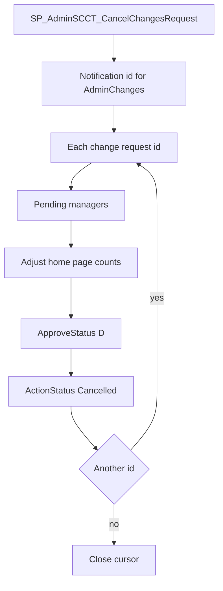

# SP_AdminSCCT_CancelChangesRequest

## What it does

Cancels one or more admin change requests. For each id it tells the pending approvers and the cancelling employee to adjust their home-page counts, sets pending `TRequestWorkflows` rows to `D`, and sets the header `ActionStatus` to `Cancelled`.

## Parameters

| Name | Direction | What it is for |
|---|---|---|
| `@ChangeRequestId` | in | Comma-separated change request ids. The tracker passes one id per call. |
| `@EmployeeId` | in | Employee who cancelled. Stored in `UpdatedBy` and `CancelledBy`. |

## Call sequence

```mermaid
sequenceDiagram
  participant Caller
  participant Main as SP_AdminSCCT_CancelChangesRequest
  participant Note as Fn_GetHomePageNotificationIdByRequestType
  participant Cnt as Sp_InsHomePageNotificationCnts
  Caller->>Main: execute
  Main->>Note: request type AdminChanges
  loop each id from Split
    Main->>Cnt: decrement pending approvers
    Main->>Cnt: decrement the canceller by-me count
  end
```

## Callers

No other procedure or function calls this object.

## Nested

| Object | Kind | When | Page |
|---|---|---|---|
| `Fn_GetHomePageNotificationIdByRequestType` | function | once, for request type `AdminChanges` | [Fn_GetHomePageNotificationIdByRequestType](/docs/database/hrms/Fn_GetHomePageNotificationIdByRequestType) |
| `Split` | function | split `@ChangeRequestId` | [Split](/docs/database/hrms/Split) |
| `Sp_InsHomePageNotificationCnts` | procedure | twice per id | [Sp_InsHomePageNotificationCnts](/docs/database/hrms/Sp_InsHomePageNotificationCnts) |

## Steps

From `HRMS-DATABASE/HRMS/STOREPROCEDURE/SP_AdminSCCT_CancelChangesRequest.sql`.

1. Resolve the home-page notification id for `AdminChanges`.
2. Read `Employerid` from `TEmployee` for `@EmployeeId`.
3. Open a cursor over `dbo.Split(@ChangeRequestId, ',')`.
4. For each id, read `RequestType` from `TAdminChangesApprovals`.
5. Collect `ManagerId` values on `TRequestWorkflows` that are still `P` for that id and request type.
6. Call `Sp_InsHomePageNotificationCnts` for those managers with pending-action `-1`, and again for `@EmployeeId` with by-me count `-1`. The procedure name argument is the string `SP_CancelAdminChangesRequest`.
7. Update matching pending workflow rows to `ApproveStatus = D`.
8. Update the header to `ActionStatus = Cancelled`, set `CancelledBy` and `CancellationDate`, then fetch the next id.
9. There is no transaction around the cursor.

## Tables

| Table | Read or write |
|---|---|
| `TEmployee` | read |
| `TAdminChangesApprovals` | read and write |
| `TRequestWorkflows` | read and write |

`THomepageNotifications`, `THomePageNotificationCnts`, and `THomePageCntsDetails` are touched inside the nested notification procedures.

## Flow


