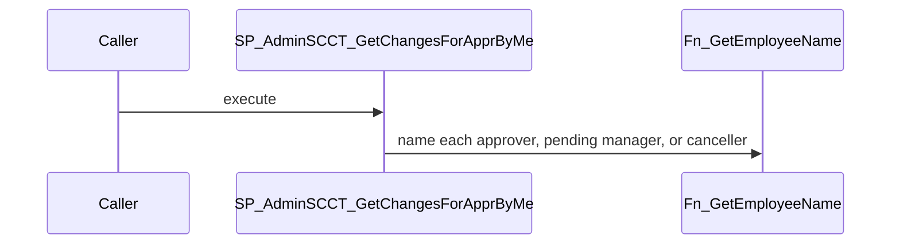
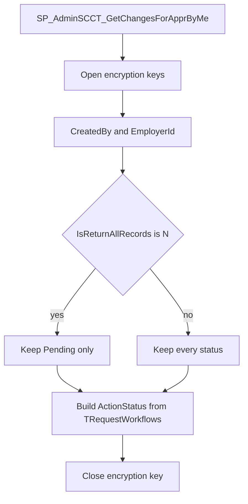

# SP_AdminSCCT_GetChangesForApprByMe

## What it does

Lists admin setup changes created by one employee for one organisation. With `@IsReturnAllRecords = N` only `Pending` rows come back. With `Y` every status comes back. The grid label `ActionStatus` is a sentence built from `TRequestWorkflows` (who approved, who it is pending with, who cancelled, who rejected).

## Parameters

| Name | Direction | What it is for |
|---|---|---|
| `@EmployeeId` | in | Creator. The filter is `TAdminChangesApprovals.CreatedBy`. |
| `@EmployerId` | in | Organisation on the header. |
| `@IsReturnAllRecords` | in | `N` (the script default) keeps `ActionStatus = Pending`. Any other value, including the tracker's `Y`, keeps the row's own status. |

## Call sequence

## Callers

No other procedure or function calls this object.

## Nested

| Object | Kind | When | Page |
|---|---|---|---|
| `Sp_OpenEncryptionKeys` | procedure | start of the batch | [Sp_OpenEncryptionKeys](/docs/database/hrms/Sp_OpenEncryptionKeys) |
| `Fn_GetEmployeeName` | function | every status sentence that names a manager or canceller | [Fn_GetEmployeeName](/docs/database/hrms/Fn_GetEmployeeName) |
| `SP_CloseEncryptionKey` | procedure | after the select | [SP_CloseEncryptionKey](/docs/database/hrms/SP_CloseEncryptionKey) |

## Steps

From `HRMS-DATABASE/HRMS/STOREPROCEDURE/SP_AdminSCCT_GetChangesForApprByMe.sql`.

1. Open encryption keys.
2. Select `ChangeRequestID`, `PageName`, a display `ActionType` (`Add` or `Edit`, and `Add` for `UserAccessRightManagement`), the raw `ActionStatus` as `RequestStatus`, a narrative `ActionStatus`, `CreatedDate`, and `ActionFor`.
3. Keep rows where `CreatedBy` and `EmployerId` match the parameters. When `@IsReturnAllRecords` is `N`, also require `ActionStatus = Pending`.
4. Build the narrative from `TRequestWorkflows` on `RequestTransid` and `RequestType`. Pending uses approve status `C` and `P`. Cancelled uses `CancelledBy`. Approved uses `C` with a comment. Rejected uses `R` with a comment, and prefixes earlier `C` rows when any exist.
5. Order by `CreatedDate` descending and close the encryption key.

## Tables

| Table | Read or write |
|---|---|
| `TAdminChangesApprovals` | read |
| `TRequestWorkflows` | read |

## Flow

