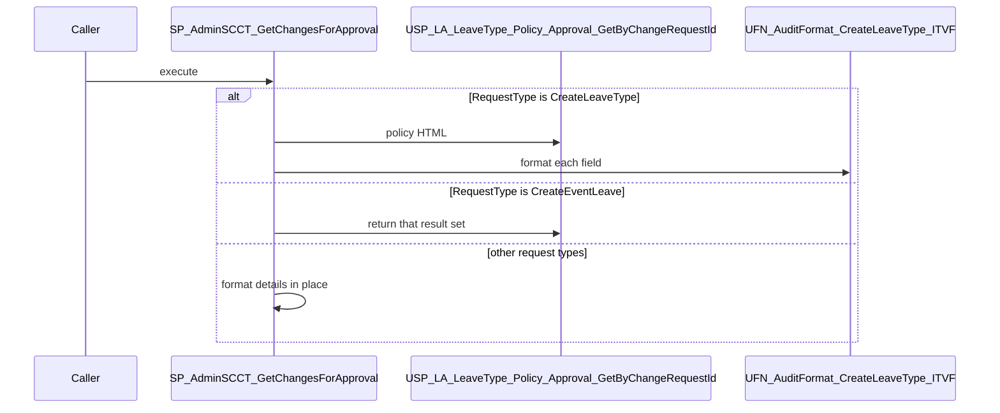
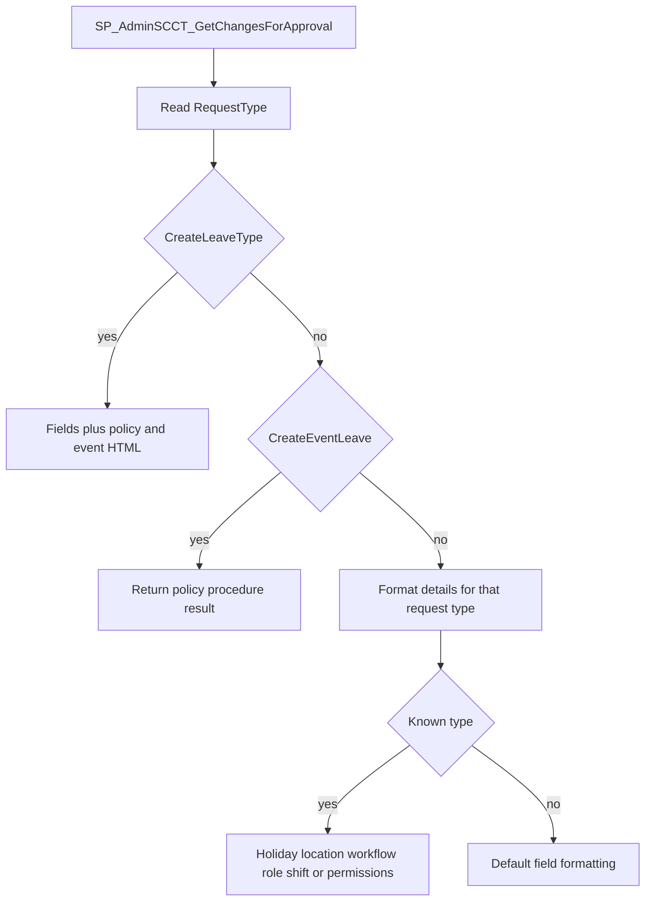

# SP_AdminSCCT_GetChangesForApproval

## What it does

Returns the field comparison for one admin change request. It reads `RequestType` from `TAdminChangesApprovals` and formats `TAdminChangesApprovalDetails` into `FieldName`, `NewValue`, and `OldValue`. Leave-type and event-leave requests also pull policy HTML from `USP_LA_LeaveType_Policy_Approval_GetByChangeRequestId`.

## Parameters

| Name | Direction | What it is for |
|---|---|---|
| `@ChangeRequestID` | in | Header id whose detail rows are formatted. |

## Call sequence

## Callers

No other procedure or function calls this object.

## Nested

| Object | Kind | When | Page |
|---|---|---|---|
| `Sp_OpenEncryptionKeys` | procedure | start | [Sp_OpenEncryptionKeys](/docs/database/hrms/Sp_OpenEncryptionKeys) |
| `USP_LA_LeaveType_Policy_Approval_GetByChangeRequestId` | procedure | `CreateLeaveType` and `CreateEventLeave` | [USP_LA_LeaveType_Policy_Approval_GetByChangeRequestId](/docs/database/hrms/USP_LA_LeaveType_Policy_Approval_GetByChangeRequestId) |
| `UFN_AuditFormat_CreateLeaveType_ITVF` | function | `CreateLeaveType` field rows | [UFN_AuditFormat_CreateLeaveType_ITVF](/docs/database/hrms/UFN_AuditFormat_CreateLeaveType_ITVF) |
| `Fn_GetEmployeeName` | function | workflow group and the default branch | [Fn_GetEmployeeName](/docs/database/hrms/Fn_GetEmployeeName) |
| `Fn_GetEmployeeNameByEmployeeID` | function | `EmployeeSummaryPermissions` employee id lists | [Fn_GetEmployeeNameByEmployeeID](/docs/database/hrms/Fn_GetEmployeeNameByEmployeeID) |
| `Split` | function | comma or pipe lists of ids | [Split](/docs/database/hrms/Split) |
| `SP_CloseEncryptionKey` | procedure | end | [SP_CloseEncryptionKey](/docs/database/hrms/SP_CloseEncryptionKey) |

`STRING_SPLIT` is a built-in and is not listed.

## Steps

From `HRMS-DATABASE/HRMS/STOREPROCEDURE/SP_AdminSCCT_GetChangesForApproval.sql`.

1. Open encryption keys and read `RequestType` for `@ChangeRequestID`.
2. `CreateLeaveType`. Load policy rows, build HTML from `TLeaveEventDetail_ChangeApproval` and `tLeaveEventDetails`, then return detail fields through `UFN_AuditFormat_CreateLeaveType_ITVF`, plus a leave-event row and the policy rows. Audit columns such as `CreatedBy` and `EmployerId` are excluded.
3. `CreateEventLeave`. Execute the policy procedure and return its result set (`RuleName`, `NewHtml`, `OldHtml`).
4. `HolidayMaster` and `WeeklyOffMaster`. Map active, calendar, holiday date, and half-day flags. Calendar id becomes `TCalendarMaster.CalendarName`.
5. `EmployeeSummaryPermissions`. Map menu, tab, role, and employee id lists to names.
6. `LocationMaster`. Map country id to `TCOUNTRY.NICENAME`.
7. `WorkflowGroup`. Expand employee, location, and business-unit lists and format `EffectiveDate`.
8. `UserAccessRightManagement`. Map role and reporting type.
9. `RolesPermissions` and `UsersPermissions`. Read `TabId` or `PageId` and expand location, business unit, role, page, user, and tab values. `PageId` and `TabId` strings use a `~` editable flag.
10. `EmploymentTypeMaster`. Map active, prefix, confirmed, and clubbed employment types.
11. `ShiftMaster`. Format times, grace fields, and monitoring frequency.
12. `LeaveCreditRules`. Map pro-rata and period of credit.
13. `RoleAccessRightManagement`. Return the role fields for this id, then union permission fields stored on `ChangeRequestID + 1`.
14. Any other request type. The default branch maps active, reporting type, calendars, locations, business units, designations, roles, gender, grade, marital status, employees, employment types, pages, and tabs.
15. Close the encryption key.

## Tables

| Table | Read or write |
|---|---|
| `TAdminChangesApprovals` | read |
| `TAdminChangesApprovalDetails` | read |
| `TLeaveEventDetail_ChangeApproval` | read |
| `tLeaveEventDetails` | read |
| `TCalendarMaster` | read |
| `TMenuDetails` | read |
| `TTabDetails` | read |
| `TRoles` | read |
| `TEmployee` | read |
| `TEmployeeInfo` | read |
| `TUserEmployee` | read |
| `TCOUNTRY` | read |
| `TLocation` | read |
| `TOrgHierarchyDetails` | read |
| `TEmployerDetails` | read |
| `TMEmploymentTypes` | read |
| `TTitle` | read |
| `TEmployeeRoleMaster` | read |
| `TGender` | read |
| `TGrade` | read |
| `TMaritalStatus` | read |

Policy and lapse tables are read inside `USP_LA_LeaveType_Policy_Approval_GetByChangeRequestId`, not in this script.

## Flow

