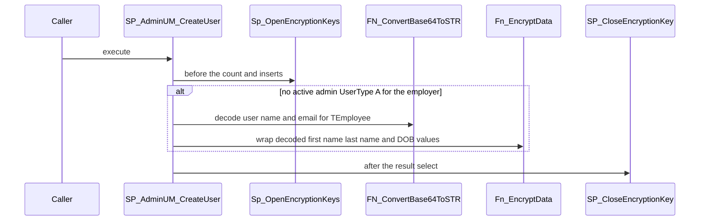
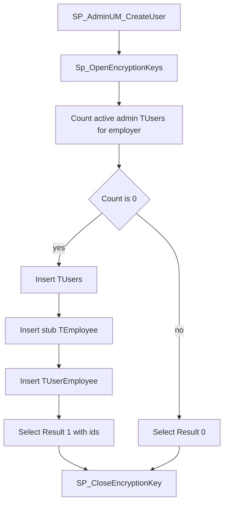

# SP_AdminUM_CreateUser

## What it does

Creates the first active administrator login for an employer when none exists yet. It inserts one `TUsers` row (`UserType` `A`), a stub `TEmployee` row, and a `TUserEmployee` link, then returns `Result` `1` with the new ids. If an active admin already exists for that employer, it returns `Result` `0` and inserts nothing.

## Parameters

| Name | Direction | What it is for |
|---|---|---|
| `@userName` | in | Base64 user name stored on `TUsers.UserName` and decoded for the stub employee first name and related fields |
| `@password` | in | Password string stored on `TUsers.PasswordStr` |
| `@email` | in | Base64 email stored on `TUsers.UserEmail` and decoded for `TEmployee.EmailID` |
| `@roleID` | in | Role id written to `TUsers.RoleId` |
| `@Employerid` | in | Employer for the user and stub employee |
| `@CreatedBy` | in | Creator employee id on the insert rows |

## Call sequence

## Callers

No other procedure or function calls this object. `UserManagementDAL.CreateUser` executes it from Create New User (`AddUser.aspx.cs`).

## Nested

| Object | Kind | When | Page |
|---|---|---|---|
| `Sp_OpenEncryptionKeys` | procedure | start of the body | [Sp_OpenEncryptionKeys](/docs/database/hrms/Sp_OpenEncryptionKeys) |
| `FN_ConvertBase64ToSTR` | function | decode `@userName` and `@email` for the stub employee insert | [FN_ConvertBase64ToSTR](/docs/database/hrms/FN_ConvertBase64ToSTR) |
| `Fn_EncryptData` | function | wrap decoded first name, blank last name, and placeholder DOB on the stub employee insert | [Fn_EncryptData](/docs/database/hrms/Fn_EncryptData) |
| `SP_CloseEncryptionKey` | procedure | end of the body | [SP_CloseEncryptionKey](/docs/database/hrms/SP_CloseEncryptionKey) |

## Steps

1. In `HRMS-DATABASE/HRMS/STOREPROCEDURE/SP_AdminUM_CreateUser.sql`, execute `Sp_OpenEncryptionKeys`.
2. Count `TUsers` rows for `@Employerid` where `IsActive` is `Y` and `UserType` is `A`.
3. When the count is `0`, insert `TUsers` with the six input values, `IsActive` `Y`, `UserType` `A`, and `CreatedDate` `getdate()`, then capture `SCOPE_IDENTITY()` as the new user id.
4. Insert a stub `TEmployee` row: encrypted decoded user name as `FName`, encrypted blank last name, encrypted `1/1/1900` DOB, `Gender` `1`, `PermanentAddress` `NA`, decoded email, `PlaceOfBirth` and `EthnicGroup` `NA`, plus employer and creator.
5. Insert `TUserEmployee` with the new user id and employee id.
6. Select `1` as `Result` with the new `EmployeeId` and `UserId`.
7. When the count is not `0`, select `0` as `Result` with `EmployeeId` `0` and `UserId` `0`.
8. Execute `SP_CloseEncryptionKey`.

## Tables

| Table | Read or write |
|---|---|
| `dbo.TUsers` | read, write |
| `dbo.TEmployee` | write |
| `dbo.TUserEmployee` | write |

## Flow

