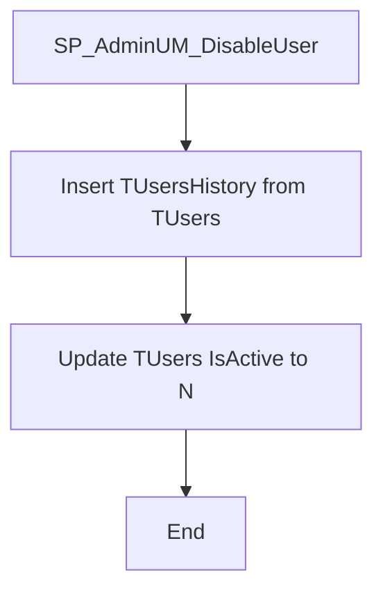

# SP_AdminUM_DisableUser

## What it does

Copies the matching `TUsers` row into `TUsersHistory`, then sets that user's `IsActive` to `N` for the given employer. It does not change `TEmployee`, `TRecruiter`, or any other table.

## Parameters

| Name | Direction | What it is for |
|---|---|---|
| `@UserId` | in | User to disable |
| `@UpdateBy` | in | Employee id written to `TUsers.ModifiedBy` |
| `@Employerid` | in | Employer filter on the history insert and the update |

## Call sequence

Calls no other procedures or functions.

## Callers

No other procedure or function calls this object. `UserManagementDAL.DisableUser` executes it from Disable User (`DisableUser.aspx`).

## Nested

Calls no other procedures or functions.

## Steps

1. In `HRMS-DATABASE/HRMS/STOREPROCEDURE/SP_AdminUM_DisableUser.sql`, insert one `TUsersHistory` row from `TUsers` where `UserID` and `Employerid` match the parameters. History columns written are `UserID`, `UserName`, `PasswordStr`, `RoleID`, `UserEmail`, `IsActive`, `ChangedOn` (from `ModifiedDate` else `CreatedDate`), and `ChangedBy` (from `ModifiedBy` else `CreatedBy`). `Employerid` on `TUsersHistory` is not populated by this insert.
2. Update `TUsers` set `IsActive = 'N'`, `ModifiedBy = @UpdateBy`, `ModifiedDate = GetDate()` for the same `UserID` and `Employerid`.
3. The procedure declares `@error_msg`, `@ErSeverity`, and `@ErState` but never uses them. There is no `TRY`/`CATCH` and no transaction inside the script.

## Tables

| Table | Read or write |
|---|---|
| `TUsers` | read then write |
| `TUsersHistory` | write |

## Flow

