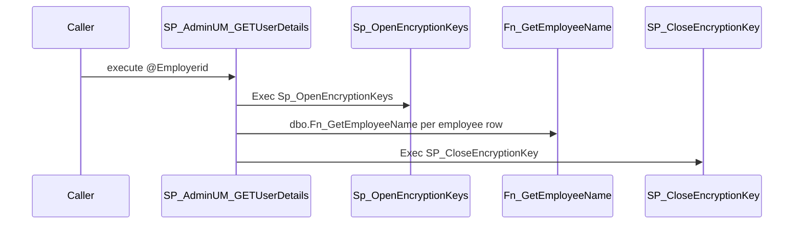
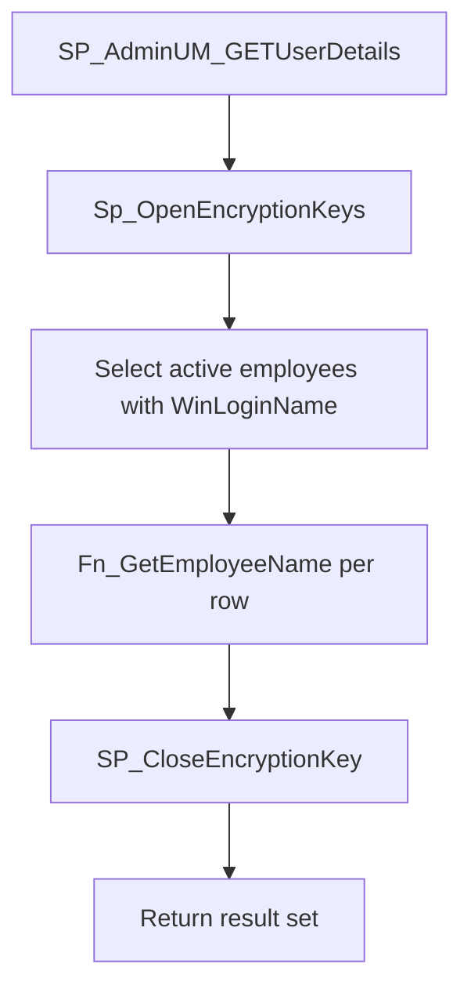

# SP_AdminUM_GETUserDetails

## What it does

Returns the Windows Login Setup grid for one employer: every active employee linked to a user, with display name, email, current `WinLoginName`, and employment number. The script opens encryption keys, runs one select, then closes encryption keys. Modification history cites PBI 17934 (encrypted employee fields) and PBI 19121 (grid sort/filter).

## Parameters

| Name | Direction | What it is for |
|---|---|---|
| `@Employerid` | in | Employer whose active employees are listed |

## Call sequence

## Callers

No other procedure or function calls this object. `UserManagementDAL.GetWinUserList` executes it (constant `SP_GETUserDetails` maps to this name). Windows Login Setup binds the result to `RadUserWinLoginList`.

## Nested

| Object | Kind | When | Page |
|---|---|---|---|
| `Sp_OpenEncryptionKeys` | procedure | always, before the select | [Sp_OpenEncryptionKeys](/docs/database/hrms/Sp_OpenEncryptionKeys) |
| `Fn_GetEmployeeName` | function | once per result row in the select list | [Fn_GetEmployeeName](/docs/database/hrms/Fn_GetEmployeeName) |
| `SP_CloseEncryptionKey` | procedure | always, after the select | [SP_CloseEncryptionKey](/docs/database/hrms/SP_CloseEncryptionKey) |

## Steps

1. In `HRMS-DATABASE/HRMS/STOREPROCEDURE/SP_AdminUM_GETUserDetails.sql`, execute `Sp_OpenEncryptionKeys`.
2. Select from `TEmployee` `e`, `TUsers` `u`, and `TUserEmployee` `eu` where `e.IsActive = 'Y'`, `e.EmployeeId = eu.EmployeeID`, `eu.UserID = u.UserID`, and `e.Employerid = @Employerid`.
3. Project `e.EmployeeId`, `dbo.Fn_GetEmployeeName(e.EmployeeId)` as `EmployeeName`, `e.EmailID`, `u.WinLoginName`, and a scalar subquery on `TEmployeeinfo` for `employmentnumber` where `t.EmployeeId = e.Employeeid`.
4. Order by `employmentnumber`.
5. Execute `SP_CloseEncryptionKey`.

## Tables

| Table | Read or write |
|---|---|
| `dbo.TEmployee` | read |
| `dbo.TUsers` | read |
| `dbo.TUserEmployee` | read |
| `dbo.TEmployeeinfo` | read |

## Flow

