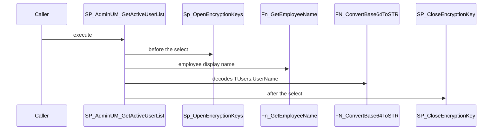
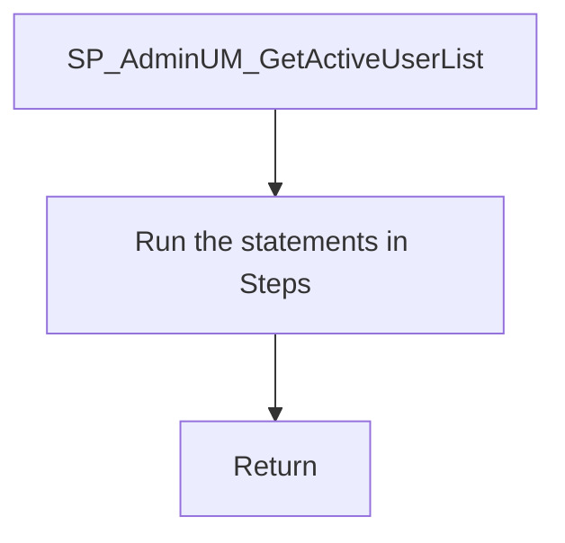

# SP_AdminUM_GetActiveUserList

## What it does

Returns active users the picker may select. Which user types appear depends on the caller's user type: an admin sees users who are not admin or super admin, a super admin sees admins, and an employee sees employees.

## Parameters

| Name | Direction | What it is for |
|---|---|---|
| `@EmployerId` | in | Employer of the employees |
| `@USerType` | in | Caller user type A, S, or E |

## Call sequence

## Callers

No other procedure or function calls this object.

## Nested

| Object | Kind | When | Page |
|---|---|---|
| `Sp_OpenEncryptionKeys` | procedure | before the select | [Sp_OpenEncryptionKeys](/docs/database/hrms/Sp_OpenEncryptionKeys) |
| `Fn_GetEmployeeName` | function | employee display name | [Fn_GetEmployeeName](/docs/database/hrms/Fn_GetEmployeeName) |
| `FN_ConvertBase64ToSTR` | function | decodes TUsers.UserName | [FN_ConvertBase64ToSTR](/docs/database/hrms/FN_ConvertBase64ToSTR) |
| `SP_CloseEncryptionKey` | procedure | after the select | [SP_CloseEncryptionKey](/docs/database/hrms/SP_CloseEncryptionKey) |

## Steps

1. Open encryption keys.
2. Join active employees (IsActive not P) to TUserEmployee and active TUsers for the employer.
3. Filter by @USerType and return UserID, employee name, decoded user name, and a combined label.
4. Close encryption keys.

## Tables

| Table | Read or write |
|---|---|
| `TEmployee` | read |
| `TUserEmployee` | read |
| `TUsers` | read |

## Flow

