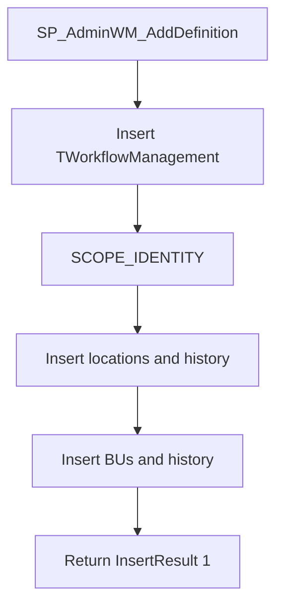

# SP_AdminWM_AddDefinition

## What it does

Inserts a new workflow definition header into `TWorkflowManagement`, then inserts optional location and business-unit scope rows (and matching history rows) from comma-separated id lists. Returns a single-row result with `InsertResult` = 1.

## Parameters

| Name | Direction | What it is for |
|---|---|---|
| `@WorkflowName` | in | Display name |
| `@WorkflowDescription` | in | Description |
| `@RoutingLevels` | in | Max approval levels |
| `@MappedPages` | in | Mapped `ModulePageId` value(s) as varchar |
| `@WorkflowDefinitionTree` | in | XML tree (Add Workflow passes empty) |
| `@IsDefaultWorkFlow` | in | Default / Org 0 flag |
| `@IsEnable` | in | Enabled flag |
| `@CreatedBy` | in | Creating employee id |
| `@Employerid` | in | Tenant |
| `@ModuleId` | in | HRMS module |
| `@IsLocationMapped` | in | Optional; default 0 |
| `@IsBUMapped` | in | Optional; default 0 |
| `@IsAllBUSelected` | in | Optional; default 0 |
| `@IsAllLocationSelected` | in | Optional; default 0 |
| `@Locations` | in | Optional comma-separated location ids |
| `@BusinessUnitIDs` | in | Optional comma-separated BU ids |

## Call sequence

Calls no other procedures or functions.

## Callers

No other procedure or function calls this object (comment-only / template exec strings exist in `uspProcessAddWorkFlowTempalte.sql`). Application caller: `WorkflowManagementDAL.AddWorkflowDefinition`.

| Object | Kind | Page |
|---|---|---|
| — | — | No other procedure or function calls this object. |

## Nested

Calls no other procedures or functions.

## Steps

1. Insert one row into `TWorkflowManagement` with the input columns and `IsDelete` 0 (`SP_AdminWM_AddDefinition.sql`).
2. Capture `@WorkflowId` from `SCOPE_IDENTITY()`.
3. Split `@Locations` and insert into `TWorkFlowLocations`, then copy those rows into `TWorkFlowLocationsHistory`.
4. Split `@BusinessUnitIDs` and insert into `TWorkFlowBusinessUnits`, then copy into `TWorkFlowBusinessUnitsHistory` (history column named `LocationID` receives `BusinessUnitID`).
5. Select `1` as `InsertResult`.

## Tables

| Table | Read or write |
|---|---|
| `TWorkflowManagement` | write |
| `TWorkFlowLocations` | write |
| `TWorkFlowLocationsHistory` | write |
| `TWorkFlowBusinessUnits` | write |
| `TWorkFlowBusinessUnitsHistory` | write |

## Flow

