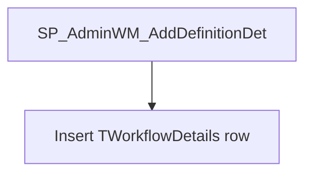

# SP_AdminWM_AddDefinitionDet

## What it does

Inserts one materialised workflow detail row (manager, role code, routing level, and notification XML blobs) into `TWorkflowDetails`. Define Workflow save calls it once per resolved manager at each level after clearing prior details.

## Parameters

| Name | Direction | What it is for |
|---|---|---|
| `@WorkflowId` | in | Parent workflow |
| `@ManagerId` | in | Resolved approver employee id |
| `@WorkflowRole` | in | Role code (up to 2 chars) |
| `@WorkflowName` | in | Workflow name copy |
| `@RoutingLevels` | in | Level number |
| `@LevelNotifications` | in | Level notification XML/text |
| `@ApproversNotifications` | in | Approve-notify payload |
| `@RejectionNotifications` | in | Reject-notify payload |
| `@PullbackNotifications` | in | Pullback-notify payload |
| `@CreatedBy` | in | Saving employee |

## Call sequence

Calls no other procedures or functions.

## Callers

No other procedure or function calls this object.

Node `WorkflowDAL.saveWorkflowDetails` calls it from `ProcessWorkFlowXml`.

## Nested

Calls no other procedures or functions.

## Steps

1. Insert one row into `TWorkflowDetails` with `IsDelete = 0`, `CreatedDate = GETDATE()`, and `UpdatedBy = @CreatedBy` (`SP_AdminWM_AddDefinitionDet.sql`).

## Tables

| Table | Read or write |
|---|---|
| `TWorkflowDetails` | write |

## Flow

