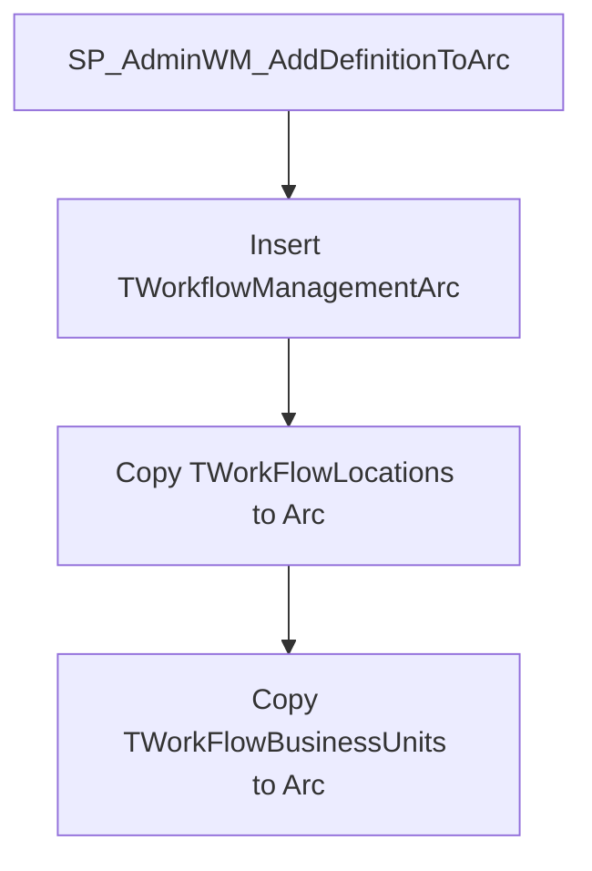

# SP_AdminWM_AddDefinitionToArc

## What it does

Archives a workflow definition header into `TWorkflowManagementArc`, then copies that workflow's location and business-unit map rows into `TWorkFlowLocationsArc` and `TWorkFlowBusinessUnitsArc`. Used when Define Workflow updates an already-defined tree so the prior snapshot is kept.

## Parameters

| Name | Direction | What it is for |
|---|---|---|
| `@WorkflowId` | in | Workflow being archived |
| `@WorkflowName` | in | Name snapshot |
| `@WorkflowDescription` | in | Description snapshot |
| `@RoutingLevels` | in | Routing level count snapshot |
| `@MappedPages` | in | Mapped page ids snapshot |
| `@WorkflowDefinitionTree` | in | Prior XML tree |
| `@CreatedBy` | in | Original creator |
| `@CreatedDate` | in | Original create date |
| `@UpdatedBy` | in | Last updater on the live row |
| `@UpdatedDate` | in | Last update date on the live row |
| `@IsDelete` | in | Delete flag snapshot |
| `@Employerid` | in | Organisation |
| `@ModuleId` | in | Module |
| `@IsLocationMapped` | in | Location map flag. Default 0 |
| `@IsBUMapped` | in | BU map flag. Default 0 |
| `@IsAllBUSelected` | in | All-BU flag. Default 0 |
| `@IsAllLocationSelected` | in | All-location flag. Default 0 |

## Call sequence

Calls no other procedures or functions.

## Callers

No other procedure or function calls this object.

Node `WorkflowBLL.UpdateWorkflow` calls it when the prior `WorkflowDefinitionTree` was already defined.

## Nested

Calls no other procedures or functions.

## Steps

1. Insert the supplied header fields into `TWorkflowManagementArc` (`SP_AdminWM_AddDefinitionToArc.sql`).
2. Insert matching `TWorkFlowLocations` rows into `TWorkFlowLocationsArc`.
3. Insert matching `TWorkFlowBusinessUnits` rows into `TWorkFlowBusinessUnitsArc`.

## Tables

| Table | Read or write |
|---|---|
| `TWorkflowManagementArc` | write |
| `TWorkFlowLocations` | read |
| `TWorkFlowLocationsArc` | write |
| `TWorkFlowBusinessUnits` | read |
| `TWorkFlowBusinessUnitsArc` | write |

## Flow

