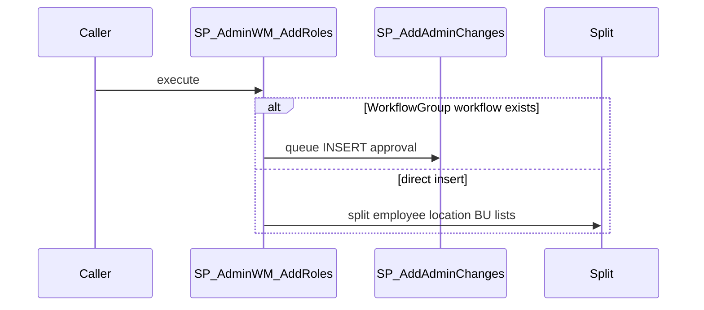
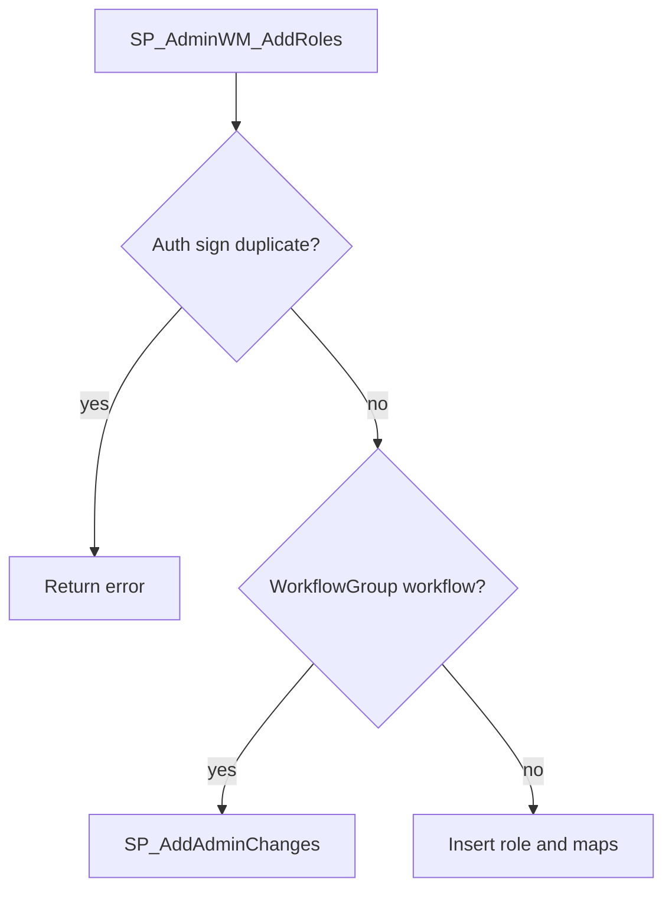

# SP_AdminWM_AddRoles

## What it does

Creates a workflow group. Rejects a second authorized-signatory group for the employer. When a WorkflowGroup-mapped workflow exists for the employer, it queues an admin-change approval via `SP_AddAdminChanges` instead of writing immediately. Otherwise it inserts `TRoleManagement` and the employee / location / business-unit mapping rows from comma-separated lists.

## Parameters

| Name | Direction | What it is for |
|---|---|---|
| `@RoleName` | in | Group name |
| `@RoleDescription` | in | Description |
| `@EffectiveDate` | in | Effective from |
| `@EmployeeID` | in | Comma-separated employee ids |
| `@LocationId` | in | Comma-separated location ids |
| `@BusinessUnitId` | in | Comma-separated business-unit ids |
| `@CreatedBy` | in | Creating employee |
| `@Employerid` | in | Organisation |
| `@IsAuthSign` | in | Authorized-signatory flag (`Y`/`N`) |
| `@IsActive` | in | Active flag |

## Call sequence

## Callers

No other procedure or function calls this object.

Node Define Workflow group popup and WebForms Create Role call it through the workflow DAL/BLL.

## Nested

| Object | Kind | When | Page |
|---|---|---|---|
| `SP_AddAdminChanges` | procedure | when a WorkflowGroup-mapped workflow exists for the employer | [SP_AddAdminChanges](/docs/database/hrms/SP_AddAdminChanges) |
| `Split` | function | direct-insert branch for employee, location, and BU lists | No page yet |

## Steps

1. When `@IsAuthSign = 'Y'` and another auth-sign group already exists for the employer, return an error message and exit (`SP_AdminWM_AddRoles.sql`).
2. Look up a non-deleted workflow whose mapped page is `WorkflowGroup` for this employer.
3. If found, build an XML change payload and execute `SP_AddAdminChanges` for an INSERT approval; return empty auth-sign error message.
4. Otherwise insert `TRoleManagement`, then insert mapping rows from `dbo.Split` on the three comma-separated id lists.

## Tables

| Table | Read or write |
|---|---|
| `TRoleManagement` | read, write |
| `TWorkflowManagement` | read |
| `TModulePages` | read |
| `tRoleEmployeeMapping` | write |
| `tRoleLocationMapping` | write |
| `tRoleBusinessUnitMapping` | write |

## Flow

