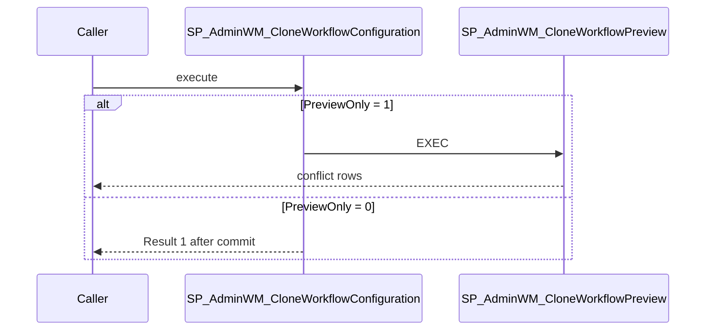
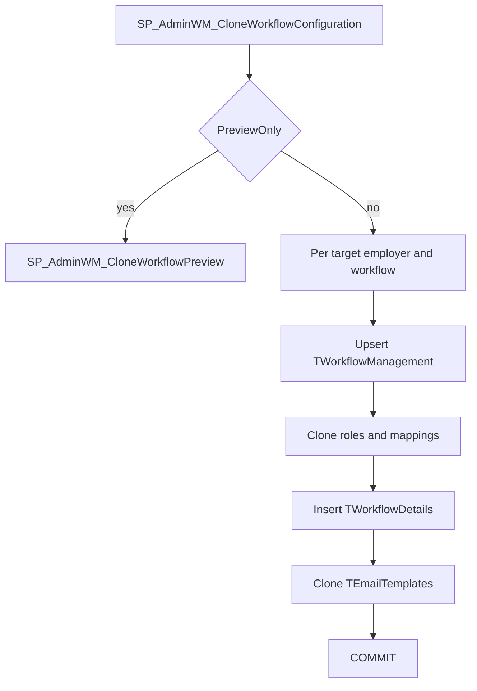

# SP_AdminWM_CloneWorkflowConfiguration

## What it does

Clones selected workflow definitions from a source employer (optional source BU/location scope) onto one or more target employers, including workflow-group roles, BU/location bindings, and email templates when flags request it. When `@PreviewOnly = 1`, it only executes the nested preview procedure and returns conflict rows without writing.

## Parameters

| Name | Direction | What it is for |
|---|---|---|
| `@sourceEmployer` | in | Source organisation |
| `@sourceBU` | in | Source business-unit filter (0 = none) |
| `@sourceLocation` | in | Source location filter (0 = none) |
| `@targetEmployers` | in | Comma-separated target employer ids |
| `@targetBUs` | in | Optional comma-separated target BU ids |
| `@targetLocations` | in | Optional comma-separated target location ids |
| `@workflowIds` | in | Comma-separated source workflow ids |
| `@IsEmployeesIncludedForWFGroup` | in | Copy `tRoleEmployeeMapping` members |
| `@IsEmailTemplatesClone` | in | Insert target `TEmailTemplates` |
| `@IsEmialTemplateOverride` | in | Soft-delete same-named target templates when cloning |
| `@IsWFGroupOverride` | in | Archive/update existing target roles |
| `@loggedEmployeeId` | in | Audit user |
| `@IsWorkflowSkip` | in | Skip when a matching target workflow already exists |
| `@IsAllBUSelected` | in | Treat clone as all-BU scope for collider detection |
| `@IsAllLocationSelected` | in | Treat clone as all-location scope |
| `@PreviewOnly` | in | `1` = call preview only and return |

## Call sequence

## Callers

No other procedure calls this object.

`WorkflowDAL.CloneWorkflowDetails` executes it from `POST /api/workflow/cloneWorkflowDetails` (Workflow Dashboard clone).

## Nested

| Object | Kind | When | Page |
|---|---|---|---|
| `SP_AdminWM_CloneWorkflowPreview` | procedure | `@PreviewOnly = 1` | [SP_AdminWM_CloneWorkflowPreview](/docs/database/hrms/SP_AdminWM_CloneWorkflowPreview) |

## Steps

1. If `@PreviewOnly = 1`, execute `SP_AdminWM_CloneWorkflowPreview` with the same parameters and return.
2. Split target employers, workflow ids, and optional BU/location lists into table variables.
3. For each target employer and each source workflow, load source `TWorkflowManagement` header and build `#DetailsWork` from `TWorkflowDetails` / `TRoleManagement`.
4. Resolve name/scope collisions; optionally archive and soft-delete colliding or absorbable target workflows into `TWorkflowManagementArc` (and location/BU arcs).
5. Insert or replace target `TWorkflowManagement`, then bind `TWorkFlowBusinessUnits` / `TWorkFlowLocations` when scoped.
6. Create or reuse target `TRoleManagement` rows (including notification-named groups), map BU/location/employees when flags say so, and insert `TWorkflowDetails`.
7. Soft-delete and re-insert `TEmailTemplates` for the target workflow when `@IsEmailTemplatesClone = 1`, honouring `@IsEmialTemplateOverride`.
8. Commit and return `Result = 1`; roll back and rethrow on error.

## Tables

| Table | Read or write |
|---|---|
| `TWorkflowManagement` | read/write |
| `TWorkflowDetails` | read/write |
| `TWorkflowManagementArc` | write |
| `TWorkFlowBusinessUnits` / `TWorkFlowBusinessUnitsArc` | read/write |
| `TWorkFlowLocations` / `TWorkFlowLocationsArc` | read/write |
| `TRoleManagement` / `TRoleManagementArc` | read/write |
| `tRoleEmployeeMapping` | read/write |
| `tRoleBusinessUnitMapping` | read/write |
| `tRoleLocationMapping` | read/write |
| `TEmailTemplates` | read/write |
| `TOrgHierarchyDetails` | read |
| `TLocation` | read |

## Unresolved calls

None.

## Flow

