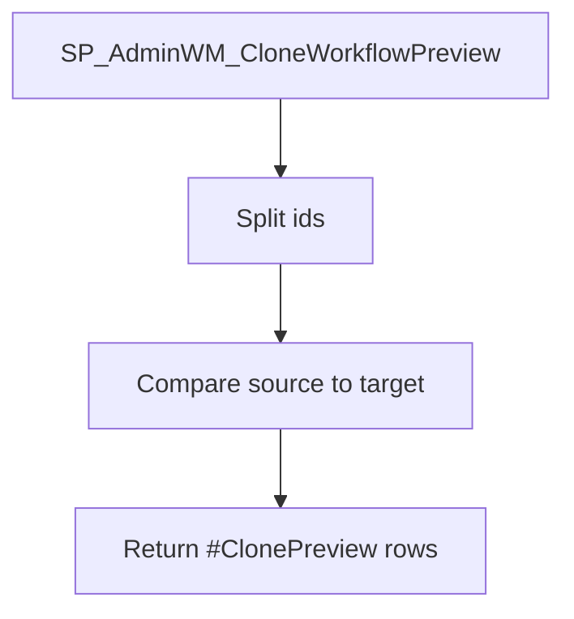

# SP_AdminWM_CloneWorkflowPreview

## What it does

Read-only dry-run companion to clone. For each target employer and source workflow id, it reports whether the workflow, workflow groups, and email templates would be created, skipped, overridden, or conflict — without inserting or updating production rows.

## Parameters

| Name | Direction | What it is for |
|---|---|---|
| `@sourceEmployer` | in | Source organisation |
| `@sourceBU` | in | Source BU filter |
| `@sourceLocation` | in | Source location filter |
| `@targetEmployers` | in | Comma-separated targets |
| `@targetBUs` | in | Optional target BUs |
| `@targetLocations` | in | Optional target locations |
| `@workflowIds` | in | Comma-separated source workflows |
| `@IsEmployeesIncludedForWFGroup` | in | Passed through for parity with clone |
| `@IsEmailTemplatesClone` | in | Include template conflict rows |
| `@IsEmialTemplateOverride` | in | Affects template action labels |
| `@IsWFGroupOverride` | in | Affects group action labels |
| `@loggedEmployeeId` | in | Unused for writes; kept for signature parity |
| `@IsWorkflowSkip` | in | Skip vs override labelling |
| `@IsAllBUSelected` | in | Scope collider rules |
| `@IsAllLocationSelected` | in | Scope collider rules |

## Call sequence

Calls no other procedures or functions.

## Callers

| Object | Kind | When |
|---|---|---|
| `SP_AdminWM_CloneWorkflowConfiguration` | procedure | `@PreviewOnly = 1` |

## Nested

Calls no other procedures or functions.

## Steps

1. Split target employers, workflow ids, and optional BU/location lists.
2. Aggregate target BU and location display names for the result set.
3. For each target × source workflow, look up existing target workflows by name and by page+scope collider rules in `TWorkflowManagement` / `TWorkFlowBusinessUnits` / `TWorkFlowLocations`.
4. Compare source roles and email templates to target `TRoleManagement` / `TEmailTemplates`.
5. Insert descriptive rows into `#ClonePreview` and return ordered conflict/preview rows.

## Tables

| Table | Read or write |
|---|---|
| `TWorkflowManagement` | read |
| `TWorkflowDetails` | read |
| `TWorkFlowBusinessUnits` | read |
| `TWorkFlowLocations` | read |
| `TRoleManagement` | read |
| `TEmailTemplates` | read |
| `TOrgHierarchyDetails` | read |
| `TLocation` | read |
| `TEmployerDetails` | read |

## Unresolved calls

None.

## Flow

