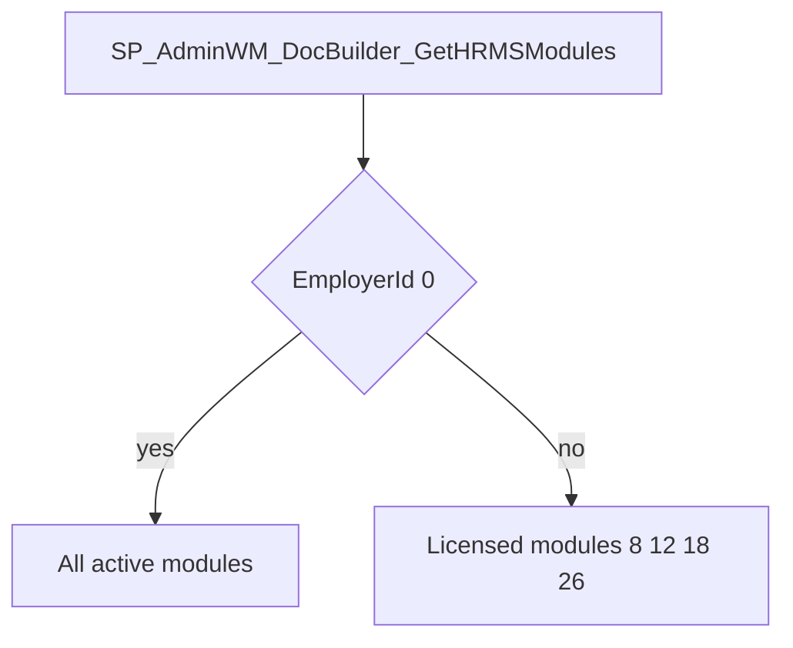

# SP_AdminWM_DocBuilder_GetHRMSModules

## What it does

Returns active HRMS modules for Doc Builder. Employer `0` returns every active module. Otherwise it returns modules licensed on the employer's root organization, limited to ids 8, 12, 18, and 26, and renames module 18 to `Offer Rolled Out`.

## Parameters

| Name | Direction | What it is for |
|---|---|---|
| `@EmployerId` | in | Employer. `0` means all active modules |

## Call sequence

Calls no other procedures or functions.

## Callers

No other procedure or function calls this object. `DocBuilderDAL.GetAdminModules` executes it from Doc Builder.

## Nested

Calls no other procedures or functions.

## Steps

1. When `@EmployerId` is 0, select distinct active `THrmsModules`.
2. Otherwise resolve `RootEmployerId`, join `TEmployerModule`, filter to module ids 8, 12, 18, 26, and return id plus display name.

## Tables

| Table | Read or write |
|---|---|
| `dbo.THrmsModules` | read |
| `dbo.TEmployerDetails` | read |
| `dbo.TEmployerModule` | read |

## Unresolved calls

None.

## Flow

