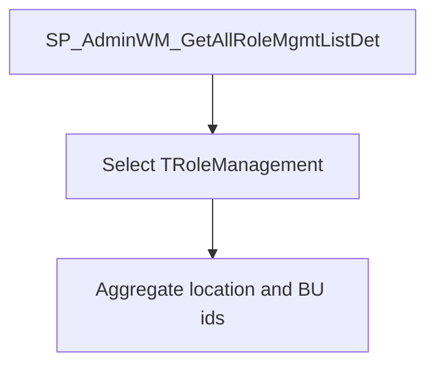

# SP_AdminWM_GetAllRoleMgmtListDet

## What it does

Lists non-deleted workflow groups for an employer (with optional inactive-mapped-role handling), including comma-separated location and business-unit ids from the mapping tables. Define Workflow uses it to duplicate-check a group name before `SP_AdminWM_AddRoles`.

The script begins with `USE [HRM-CL-Prod]`.

## Parameters

| Name | Direction | What it is for |
|---|---|---|
| `@Employerid` | in | Organisation |
| `@InactiveMappedRoles` | in | Optional inactive-mapped-role filter. Default 0 |

## Call sequence

Calls no other procedures or functions.

## Callers

No other procedure or function calls this object.

Node `WorkflowDAL.GetAllRolesCreated` calls it from `AddRolesInWorkflow`.

## Nested

Calls no other procedures or functions.

## Steps

1. Select role header columns from `TRoleManagement` for the employer with `IsDelete = 0` (`SP_AdminWM_GetAllRoleMgmtListDet.sql`).
2. Aggregate location and business-unit ids from `tRoleLocationMapping` / `tRoleBusinessUnitMapping` as comma-separated strings.
3. Apply the `@InactiveMappedRoles` branch as coded in the remainder of the script.

## Tables

| Table | Read or write |
|---|---|
| `TRoleManagement` | read |
| `tRoleLocationMapping` | read |
| `tRoleBusinessUnitMapping` | read |

## Flow

