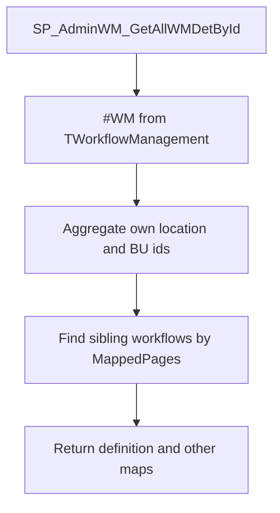

# SP_AdminWM_GetAllWMDetById

## What it does

Loads one non-deleted workflow definition by id, including the XML tree, BU/location map flags, comma-separated location and business-unit ids for that workflow, whether any `TWorkflowDetails` rows exist (`WorkflowDefined`), and `IsNotificationOnlyWorkFlow` from the mapped module page. A second result set lists location and business-unit ids already used by other workflows that share any of the same mapped pages for the same employer.

## Parameters

| Name | Direction | What it is for |
|---|---|---|
| `@WorkflowId` | in | Workflow definition to load |

## Call sequence

Calls no other procedures or functions.

## Callers

No other procedure or function calls this object.

Node Define Workflow save loads it from `WorkflowDAL.GetWorkflowDetailsById` before rewriting the tree.

## Nested

Calls no other procedures or functions.

## Steps

1. Copy the matching `TWorkflowManagement` row into `#WM`, including `WorkflowDefined` from existence of non-deleted `TWorkflowDetails` (`SP_AdminWM_GetAllWMDetById.sql`).
2. Aggregate distinct location ids from `TWorkFlowLocations` and business-unit ids from `TWorkFlowBusinessUnits` for this workflow.
3. Find other non-deleted workflows for the same employer that share any mapped page id (via `STRING_SPLIT` on `MappedPages`).
4. Aggregate location and business-unit ids used by those other workflows.
5. Return the `#WM` row joined to `TModulePages` on `MappedPages = ModulePageId`, plus the other-workflow location/BU aggregates as a second result set.

## Tables

| Table | Read or write |
|---|---|
| `TWorkflowManagement` | read |
| `TWorkflowDetails` | read |
| `TWorkFlowLocations` | read |
| `TWorkFlowBusinessUnits` | read |
| `TModulePages` | read |

## Flow

