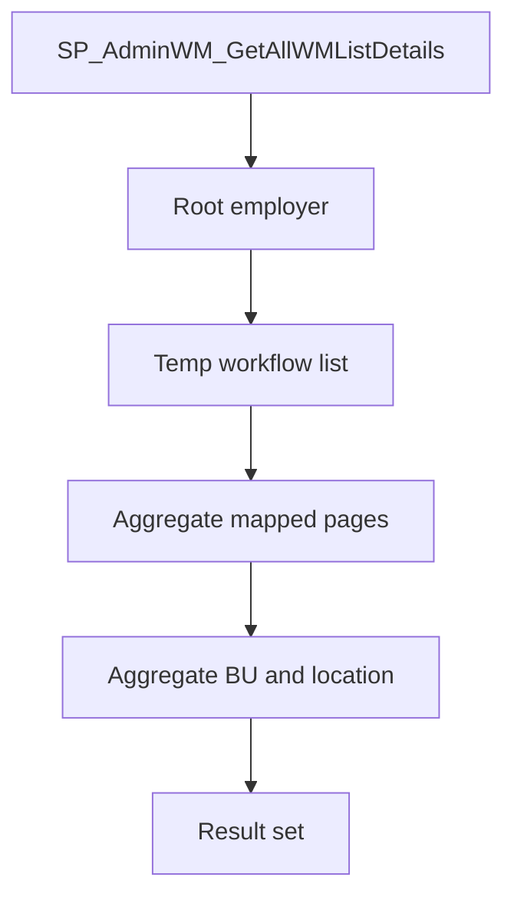

# SP_AdminWM_GetAllWMListDetails

## What it does

Returns the non-deleted workflow definition list for a super user (employer `0` only) or for a normal user (that `@Employerid` only), with module name, aggregated mapped page names, BU/location names and ids, and notification-only flag from `TModulePages`.

The script begins with `USE [HRM-CL-Prod]`.

## Parameters

| Name | Direction | What it is for |
|---|---|---|
| `@Employerid` | in | Organisation filter for non-super users |
| `@UserType` | in | `S` = super user Org 0 list; otherwise employer-scoped |

## Call sequence

Calls no other procedures or functions.

## Callers

No other procedure or function calls this object. Application caller: `WorkflowManagementDAL.GetWorkflowManagementList`.

## Nested

Calls no other procedures or functions.

## Steps

1. Resolve `@RootEmployerId` from `TEmployerDetails` (`SP_AdminWM_GetAllWMListDetails.sql`).
2. Build `#WorkflowManagement` from `TWorkflowManagement` joined to modules/employer, filtered by user type and `IsDelete` = 0.
3. Expand `MappedPages` via `STRING_SPLIT` into `#ModulePages` / `#CSVModulePages`.
4. Aggregate location and BU names from `TWorkFlowLocations` / `TWorkFlowBusinessUnits` into CSV temp tables.
5. Return the final select joining `#WorkflowManagement` to `TModulePages` and the CSV helpers, ordered by workflow name.

## Tables

| Table | Read or write |
|---|---|
| `TEmployerDetails` | read |
| `TWorkflowManagement` | read |
| `TEmployerModule` | read |
| `THrmsModules` | read |
| `TModulePages` | read |
| `TWorkFlowLocations` | read |
| `TWorkFlowBusinessUnits` | read |
| `TLocation` | read |
| `TOrgHierarchyDetails` | read |

## Flow

