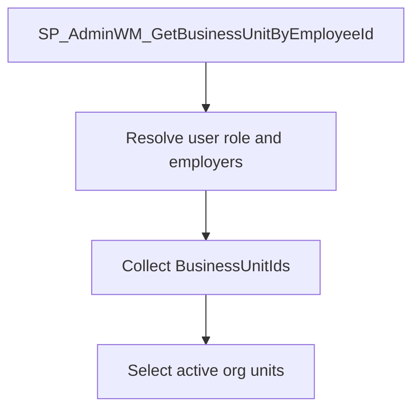

# SP_AdminWM_GetBusinessUnitByEmployeeId

## What it does

Returns business-unit rows the operator may choose. It resolves the user’s role, employer, optional global `EmployerIds`, and combined `BusinessUnitIds` from `TUSerPagesMapping` plus `TRolePagesMapping`. Units come from active `TOrgHierarchyDetails` for those employers; if no BU ids are configured, units under the root employer family are returned. Display text is `UnitName - (EmployerName)`.

## Parameters

| Name | Direction | What it is for |
|---|---|---|
| `@EmployeeId` | in | Operator employee |
| `@EmployerId` | in | Requested employer context (user’s own employer still drives mapping lookup) |

## Call sequence

Calls no other procedures or functions.

## Callers

No other procedure or function calls this object. Application caller: BGV API `employeeDAL.GetAllBusinessUnitInfo`.

## Nested

Calls no other procedures or functions. Uses `STRING_SPLIT` (SQL Server built-in).

## Steps

1. Script is `HRMS-DATABASE/HRMS/STOREPROCEDURE/SP_AdminWM_GetBusinessUnitByEmployeeId.sql`.
2. Read role, employer, and global employer ids from `TUsers` / `TUserEmployee`.
3. Build employer id table (own + split global list).
4. Collect `BusinessUnitIds` from user page mapping, then append role page mapping.
5. Select active org units for those employers, filtered by BU ids or root-employer fallback; order by unit name.

## Tables

| Table | Read or write |
|---|---|
| `dbo.TUsers` | read |
| `dbo.TUserEmployee` | read |
| `dbo.tEmployerDetails` / `dbo.TEmployerDetails` | read |
| `dbo.TUSerPagesMapping` | read |
| `dbo.TRolePagesMapping` | read |
| `dbo.TOrgHierarchyDetails` | read |

## Flow

