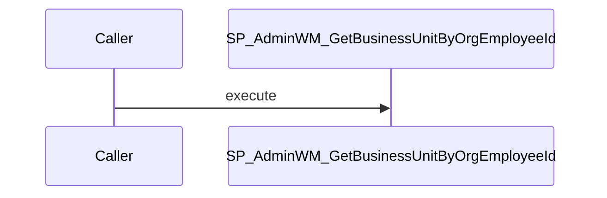
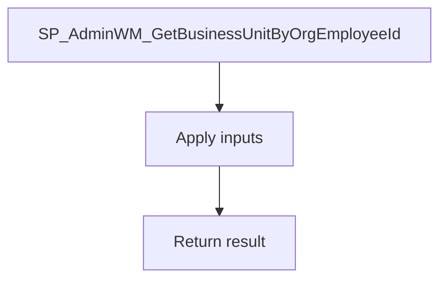

# SP_AdminWM_GetBusinessUnitByOrgEmployeeId

## What it does

Returns business-unit id/name rows for an employee across one or more employers. TIMEPORT report SPs call it via synonym when resolving optional BU scope.

## Parameters

| Name | Direction | What it is for |
|---|---|---|
| `@EmployeeId` | in | Employee id |
| `@EmployerId` | in | Employer id or CSV |

## Call sequence

## Callers

| Object | Kind | Page |
|---|---|---|
| `USP_TS_GetEmpTimeSheetReportByDateRange` | procedure | [USP_TS_GetEmpTimeSheetReportByDateRange](/docs/database/hrm-timeport/USP_TS_GetEmpTimeSheetReportByDateRange) |
| `USP_TS_GetEmpTimeSheetReportByDaily_Summary` | procedure | [USP_TS_GetEmpTimeSheetReportByDaily_Summary](/docs/database/hrm-timeport/USP_TS_GetEmpTimeSheetReportByDaily_Summary) |
| `USP_TTSEmpTimeSheet_TaskDuration` | procedure | [USP_TTSEmpTimeSheet_TaskDuration](/docs/database/hrm-timeport/USP_TTSEmpTimeSheet_TaskDuration) |
| `Sp_TS_GetComplianceReportsDetails` | procedure | [Sp_TS_GetComplianceReportsDetails](/docs/database/hrm-timeport/Sp_TS_GetComplianceReportsDetails) |

## Nested

| Object | Kind | When | Page |
|---|---|---|---|
| — | — | — | — |

## Steps

In `HRMS-DATABASE/HRMS/STOREPROCEDURE/SP_AdminWM_GetBusinessUnitByOrgEmployeeId.sql`:

1. Resolve org hierarchy / access for the employee and employer list.
2. Return UnitID / UnitName rows.

## Tables

| Table | Read or write |
|---|---|
| `TOrgHierarchyDetails` | read |
| `TEmployee` | read |

## Flow

