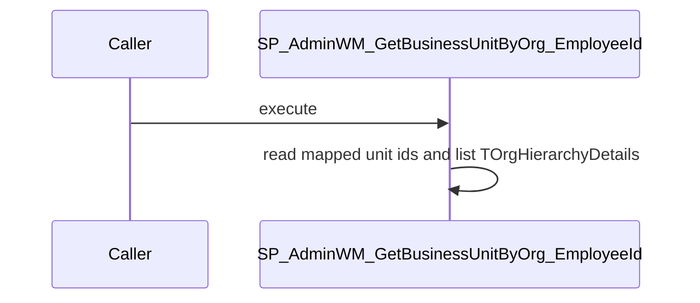
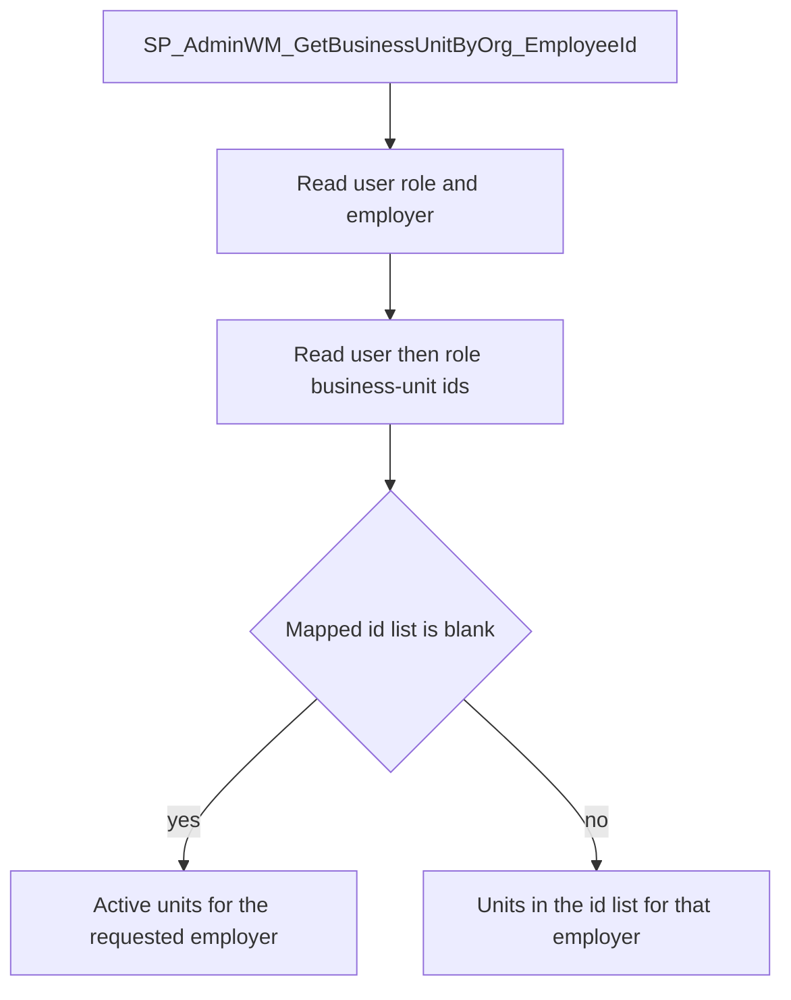

# SP_AdminWM_GetBusinessUnitByOrg_EmployeeId

## What it does

Returns active business units for one employer, limited to the units mapped to the employee when that mapping is not blank. View Organization Chart uses it for the business-unit picker. The employee-list procedure also inserts this result into `#AllowedBU` before it lists people.

A different procedure, `USP_AdminWM_GetBusinessUnitByOrg_EmployeeId`, exists beside this one. The chart path executes the `SP_AdminWM_` name.

## Parameters

| Name | Direction | What it is for |
|---|---|---|
| `@EmployeeId` | in | Employee whose user, role, and page mapping are read |
| `@EmployerId` | in | Employer whose units are returned. The API query name is `employerid` |

## Call sequence

Calls no other procedures or functions.

## Callers

| Object | Kind | Page |
|---|---|---|
| `recruitmentDAL.GetBusinessUnitsByEmployeeId` | app | [View Organization Chart](/docs/guides/admin-configuration/view-organization-chart) |
| `recruitmentDAL_V2.GetBusinessUnitsByEmployeeId` | app | V2 recruitment DAL. This screen's route uses V1 |
| `recruitmentDAL_V3.GetBusinessUnitsByEmployeeId` | app | V3 recruitment DAL. This screen's route uses V1 |
| `mobileManagementDAL.getBusinessUnitsForLookup` | app | Mobile management lookup |
| `performanceAssessmentDAL.GetOrganisationBusinessUnits` | app | Performance assessment |
| `SP_GetEmpListBy_Org_AllowedBU_EmployeeId` | procedure | [SP_GetEmpListBy_Org_AllowedBU_EmployeeId](/docs/database/hrms/SP_GetEmpListBy_Org_AllowedBU_EmployeeId) |

`SP_EmployeeDashboard_GetBusinessUnitByOrg_EmployeeId.sql` and `SP_BulkProfileUpdate_BusinessUnitByLogin_Org_Country.sql` mention this procedure in comments only.

## Nested

None.

## Steps

In `HRMS-DATABASE/HRMS/STOREPROCEDURE/SP_AdminWM_GetBusinessUnitByOrg_EmployeeId.sql`:

1. Set `NOCOUNT ON` and `READ UNCOMMITTED`.
2. From `TUsers` for the user linked in `TUserEmployee`, read `RoleId`, `EmployerId`, and `EmployerIds` when `IsGlobalAccess = 'Y'`. The employer-id table that would use `EmployerIds` is commented out and is not applied.
3. Read `BusinessUnitIds` from `TUSerPagesMapping` for that user and the user's own employer.
4. If that value is null or blank, replace it with `TRolePagesMapping.BusinessUnitIds` for the role and the same employer. Otherwise append the role ids after a comma.
5. Return `UnitID` and `UnitName` as `UnitName - (EmployerName)` from active `TOrgHierarchyDetails` rows joined to `TEmployerDetails`.
6. When the mapped id list is null or blank, keep units whose employer is `@EmployerId`.
7. When the list is not blank, keep units whose `UnitID` is in the split list and whose employer is `@EmployerId`.
8. Order by `UnitName`.

The mapping lookup uses the user's employer from `TUsers`. The result filter uses the `@EmployerId` argument. Those two employers can differ when the chart's organization picker is changed.

## Tables

| Table | Read or write |
|---|---|
| `dbo.TUsers` | read |
| `dbo.TUserEmployee` | read |
| `dbo.TUSerPagesMapping` | read |
| `dbo.TRolePagesMapping` | read |
| `dbo.TEmployerDetails` | read |
| `dbo.TOrgHierarchyDetails` | read |

## Flow

