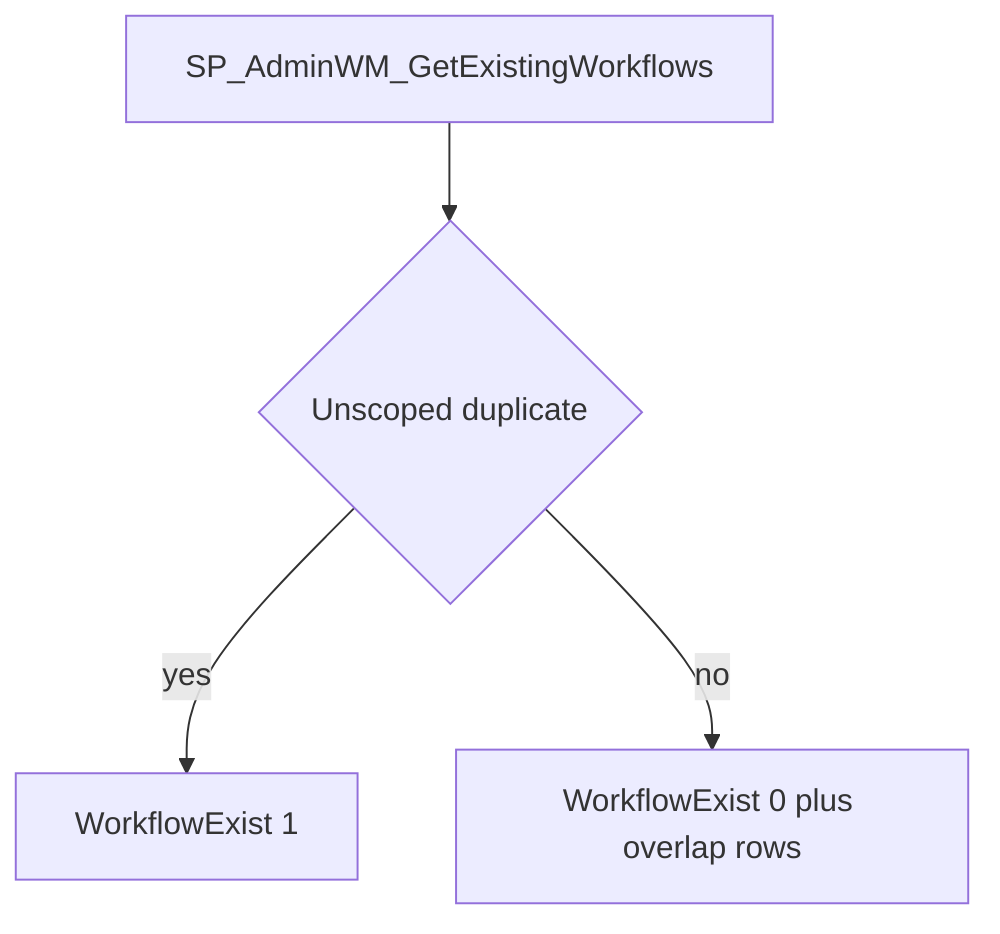

# SP_AdminWM_GetExistingWorkflows

## What it does

Validates whether another enabled, non-deleted workflow already exists for the same employer and mapped page with an overlapping “unscoped / all BU and location” rule. When that hard duplicate is not found, returns `WorkflowExist` = 0 plus a second result set of existing workflows' BU/location CSV strings for the UI to compare. When the hard duplicate is found, returns `WorkflowExist` = 1 and empty location/BU strings.

## Parameters

| Name | Direction | What it is for |
|---|---|---|
| `@WorkflowId` | in | Current id (0 on insert); excluded from matches |
| `@MappedPages` | in | Page being saved |
| `@EmployerId` | in | Tenant |
| `@IsAllBUSelected` | in | Incoming all-BU flag |
| `@IsAllLocationSelected` | in | Incoming all-location flag |
| `@Locations` | in | Optional CSV |
| `@BusinessUnitIDs` | in | Optional CSV |

## Call sequence

Calls no other procedures or functions.

## Callers

No other procedure or function calls this object. Application caller: `WorkflowManagementDAL.GetExistingWorkflowsToValidate`.

## Nested

Calls no other procedures or functions.

## Steps

1. When locations and BUs are both empty, or both all-selected flags are 1, check for an existing unscoped workflow on the same page; set `@lv_Count` (`SP_AdminWM_GetExistingWorkflows.sql`).
2. If `@lv_Count` is 0, return `WorkflowExist` 0 and a detail result set of other workflows' maps for that page.
3. Else return `WorkflowExist` 1 and empty location/BU strings.

## Tables

| Table | Read or write |
|---|---|
| `TWorkflowManagement` | read |
| `TWorkFlowLocations` | read |
| `TWorkFlowBusinessUnits` | read |

## Flow

