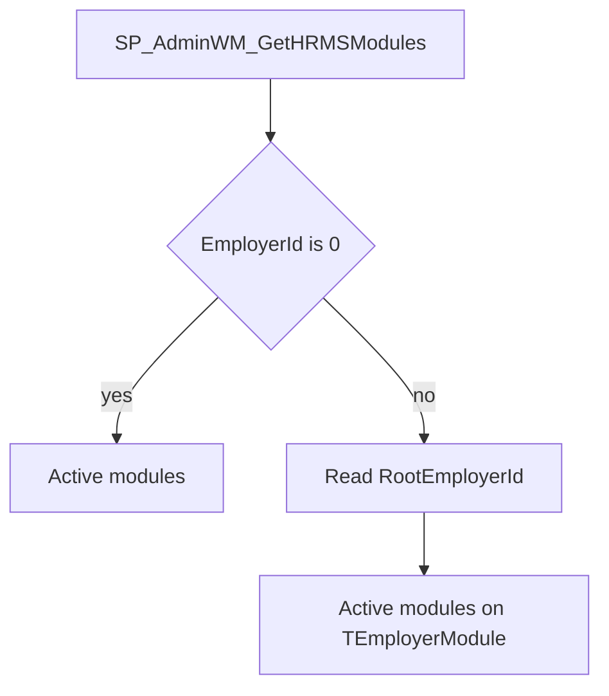

# SP_AdminWM_GetHRMSModules

## What it does

Returns distinct active module id and name. Employer `0` gets every active module. Any other employer gets the active modules licensed to that employer's root organisation.

The script begins with `USE [HRM-CL-Prod]`.

## Parameters

| Name | Direction | What it is for |
|---|---|---|
| `@EmployerId` | in | Organisation. `0` skips the licence filter |

## Call sequence

Calls no other procedures or functions.

## Callers

No other procedure or function calls this object.

The Email Template Builder module dropdown calls it from `node_server/routes/modules.js` with `Employerid` 10.

## Nested

Calls no other procedures or functions.

## Steps

1. When `@EmployerId` is 0, select distinct `ModuleId` and `ModuleName` from `THrmsModules` where `IsActive` is 1 (`SP_AdminWM_GetHRMSModules.sql`).
2. Otherwise read `RootEmployerId` from `TEmployerDetails`.
3. Select distinct active modules joined to active `TEmployerModule` rows for that root employer.

## Tables

| Table | Read or write |
|---|---|
| `THrmsModules` | read |
| `TEmployerDetails` | read, when `@EmployerId` is not 0 |
| `TEmployerModule` | read, when `@EmployerId` is not 0 |

## Flow

