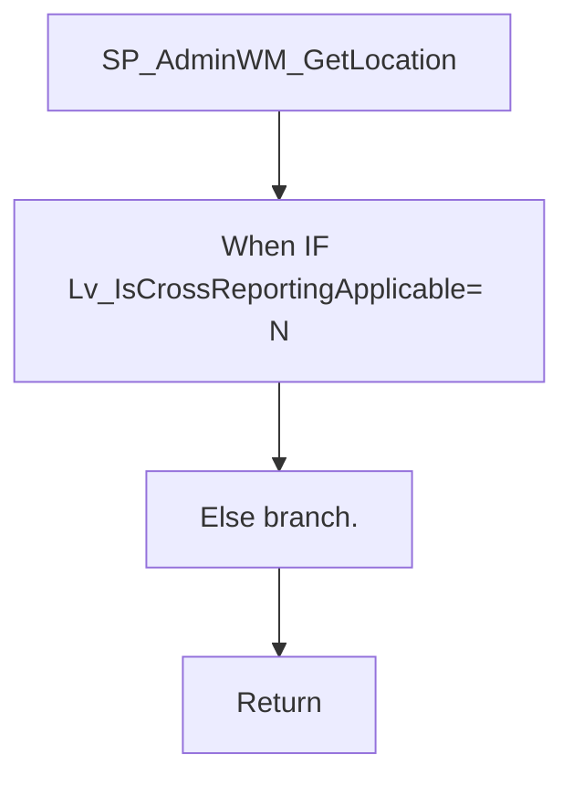

# SP_AdminWM_GetLocation

## What it does

Stored procedure `SP_AdminWM_GetLocation`. Reads `TEmployerDetails`, `TLocation`, `TCOUNTRY`. Calls no other procedure or function.

## Parameters

| Name | Direction | What it is for |
|---|---|---|
| `@Employerid` | in | INT |
| `@EmployeeId` | in | INT, default NULL |

## Call sequence

Calls no other procedures or functions.

## Callers

No other procedure or function calls this object.

## Nested

Calls no other procedures or functions.

## Steps

1. Script is `HRMS-DATABASE/HRMS/STOREPROCEDURE/SP_AdminWM_GetLocation.sql`.
2. When IF @Lv_IsCrossReportingApplicable='N'
3. Else branch.

## Tables

| Table | Read or write |
|---|---|
| `TCOUNTRY` | read |
| `TEmployerDetails` | read |
| `TLocation` | read |

## Flow

