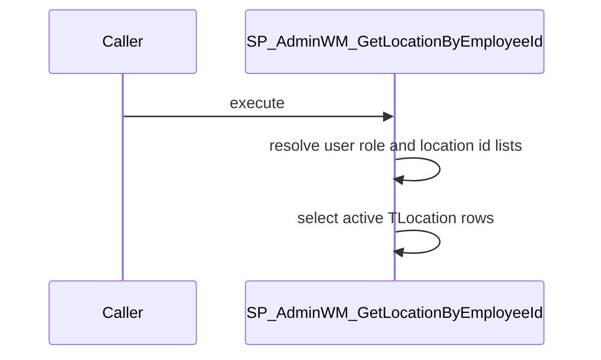
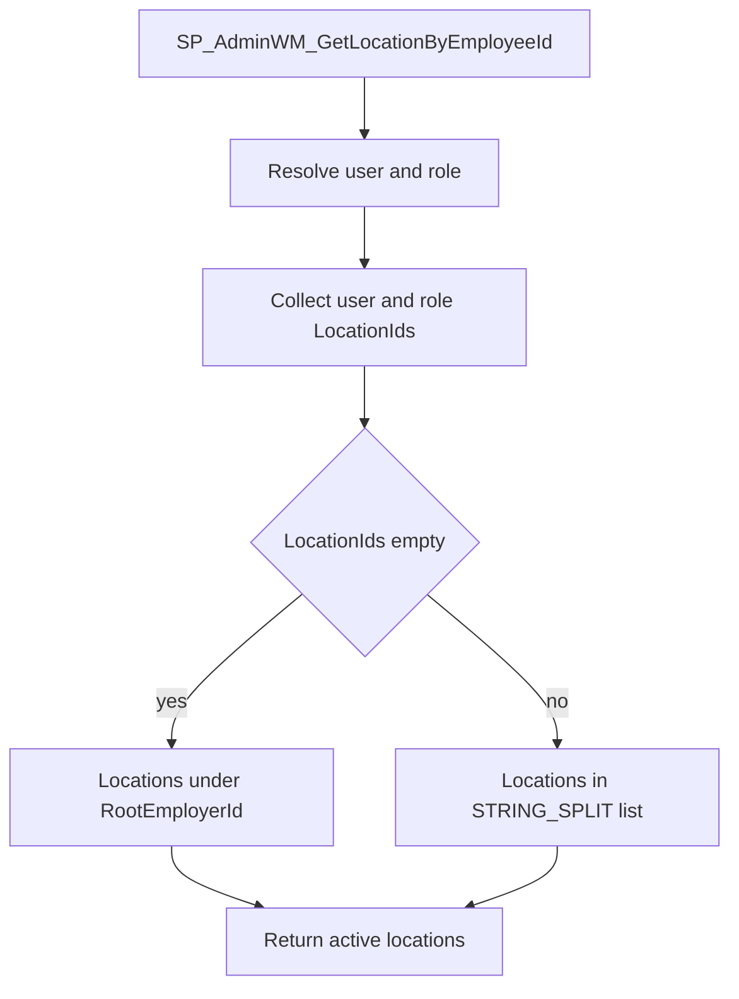

# SP_AdminWM_GetLocationByEmployeeId

## What it does

Returns active locations the calling employee may use, based on that employee's user/role location mapping. It resolves the user from `TUserEmployee`, reads role and employer from `TUsers`, collects location ids from `TUSerPagesMapping` and `TRolePagesMapping`, then returns matching active `TLocation` rows (with country name). When no location ids are mapped, it falls back to locations under the same `RootEmployerId` as the user's employer. Location names append the employer name when more than one employer shares that root.

## Parameters

| Name | Direction | What it is for |
|---|---|---|
| `@EmployeeId` | in | Employee whose user/role location rights drive the filter |
| `@EmployerId` | in | Declared on the procedure; body scopes via the user's employer from `TUsers` |

## Call sequence

Calls no other procedures or functions (uses `STRING_SPLIT` built-in only).

## Callers

No other procedure or function calls this object. `CommonDAL.GetLocationsByEmployeeId` executes it from Employee Bulk Update (`EmployeeBulkUpdate.aspx.cs`) and other screens.

## Nested

Calls no other procedures or functions.

## Steps

From `HRMS-DATABASE/HRMS/STOREPROCEDURE/SP_AdminWM_GetLocationByEmployeeId.sql`:

1. Resolve `@UserId` from `TUserEmployee` for `@EmployeeId`.
2. Read `RoleId` and `EmployerId` from `TUsers` for that user; compute root employer and sibling-employer count from `tEmployerDetails`.
3. Take `LocationIds` from `TUSerPagesMapping`, then append role mapping ids from `TRolePagesMapping`.
4. Select active `TLocation` rows joined to `TEmployerDetails` and `TCOUNTRY`, either for the root employer when no location ids are mapped, or for location ids in the comma list via `STRING_SPLIT`.
5. Order by location name.

## Tables

| Table | Read or write |
|---|---|
| `dbo.TUserEmployee` | read |
| `dbo.TUsers` | read |
| `dbo.tEmployerDetails` | read |
| `dbo.TUSerPagesMapping` | read |
| `dbo.TRolePagesMapping` | read |
| `dbo.TLocation` | read |
| `dbo.TCOUNTRY` | read |

## Flow

